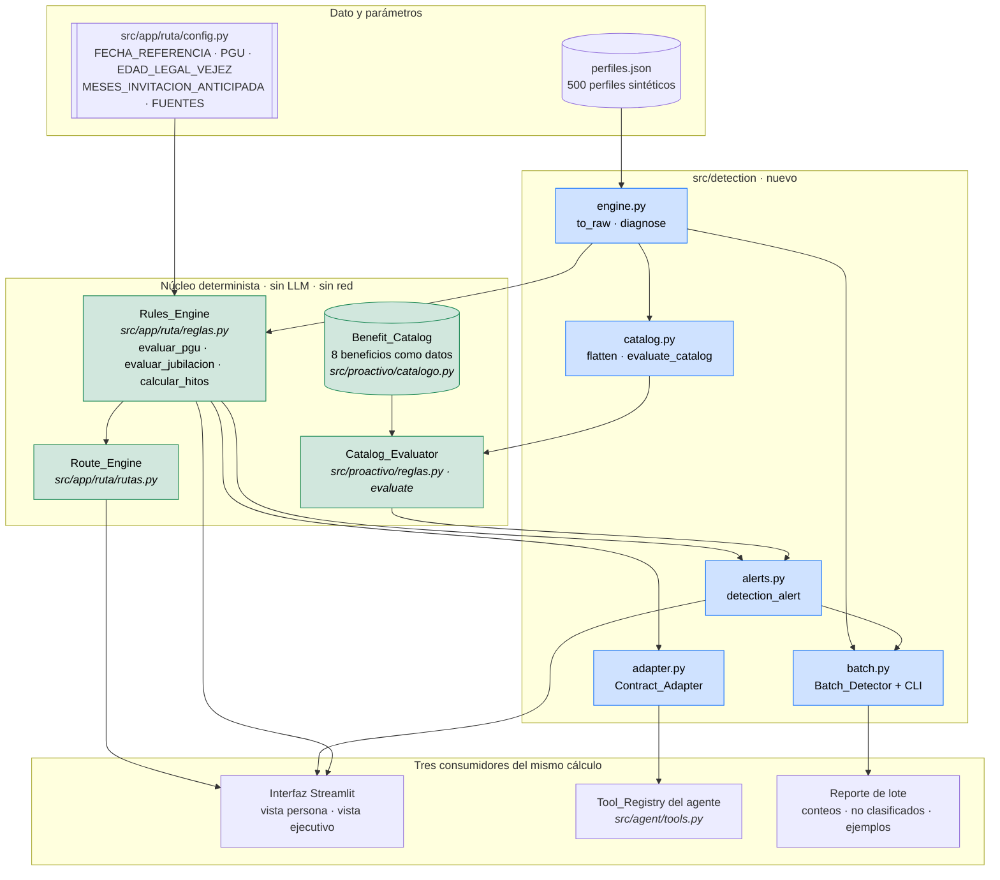
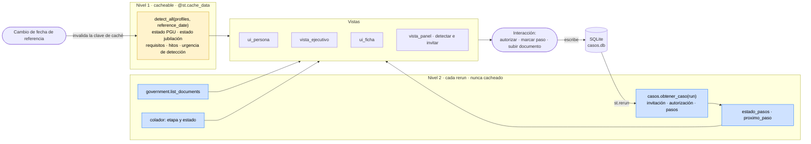
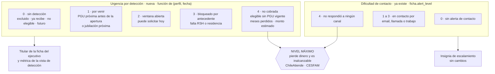
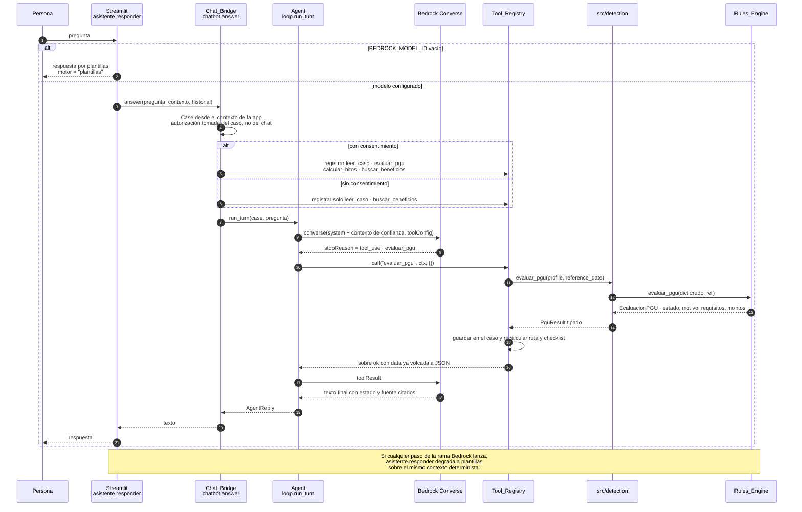

# Design Document

## Overview

Este diseño responde la pregunta del usuario — *¿cómo hacemos para que trabaje la detección y pueda conectarse a la interfaz para que se actualice y lance la alerta correspondiente?* — con tres mecanismos separados y verificables:

**(a) Cómo corre la detección.** Un núcleo determinista único (`src/detection/`) que no reimplementa reglas: envuelve el motor vigente `src/app/ruta/reglas.py` y el evaluador de catálogo `src/proactivo/reglas.py`, y los expone con tres puntos de entrada sobre el mismo cálculo: un lote CLI sobre los 500 perfiles, una llamada cacheada desde Streamlit y tres handlers del agente. Un cálculo, tres consumidores.

**(b) Cómo llega a la interfaz y se mantiene actualizada.** No hay bus de eventos. Streamlit reejecuta el script completo en cada interacción, y ese rerun *es* el mecanismo de actualización. El diseño separa dos niveles: lo que es función pura de (perfil, fecha de referencia) se cachea con `@st.cache_data`; lo que cambia en vivo (invitación, autorización, pasos completados, documentos, etapa del colador) se recomputa en cada rerun desde SQLite. Hoy la caché `diagnosticos()` no recibe la fecha de referencia, así que nunca se invalida: el cambio mínimo es pasarla como argumento.

**(c) Cómo se dispara la alerta.** La alerta se vuelve la combinación de dos dimensiones ortogonales que hoy están colapsadas en una. La que existe (`ficha.alert_level`) mide **dificultad de contacto**: en qué etapa del colador está la persona, es decir cuán inalcanzable es. La que falta, y que este feature agrega, mide **urgencia por detección**: qué se está perdiendo la persona y desde cuándo. "Lanzar" la alerta en esta demo significa recalcular un indicador visible en la ficha y en la vista de detección, no enviar un mensaje; el envío real ya existe en `src/proactivo/` (DynamoDB Streams → Lambda → SES) y comparte catálogo y reglas, no código de presentación.

La frontera del dominio es una propiedad de la arquitectura, no una recomendación: el modelo nunca ve un perfil crudo desde el chat ni calcula un estado. Recibe sobres de herramienta ya computados por el núcleo determinista (`{"ok": true, "data": ...}`), y la interfaz muestra el estado del `Eligibility_Service`, no el que el modelo redactó.

### Qué se verificó en el código y en los datos antes de diseñar

| Afirmación | Resultado |
|---|---|
| `from src import rules` en `tools.py::_load_rules` | El módulo no existe. `build_registry()` devuelve hoy `["consultar_perfil", "leer_caso"]`. Confirmado. |
| `Profile` tiene alias que calzan con el dataset | Confirmado alias por alias contra cada clave que lee `reglas.py`: `registro_civil`/`fecha_nacimiento`/`sexo`/`estado`, `rsh`/`info_pfp_disponible`/`pfp_percentil`, `residencia`/`anios_residencia_desde_20`/`resultado`, `prevision`/`pafe_estimada`, `pensiones_beneficios`/`tipo_registro`/`tipo_beneficio`/`estado`/`monto`/`tipo_pension`. **`mode="json"` es obligatorio**: con `mode="python"` las fechas quedan como `date` y los `StrEnum` como enums, y `date.fromisoformat` del motor falla. |
| `rsh.cse_tramo` es comparable con los umbrales 40/60/80 del catálogo | **Sí.** Valores observados en `rsh.csv`: 40, 50, 60, 70, 80, 90, 100. Son tramos de calificación socioeconómica en la misma escala de percentil que usa el catálogo. El mapeo `tramo_rsh = cse_tramo` es sano y no produce elegibilidad falsa. |
| `registro_civil.estado_civil` calza con el enum del catálogo | **Sí, exactamente.** Valores observados: `soltero` (166), `AUC` (45), `casado` (209), `divorciado` (48), `viudo` (32). El requisito `estado_civil in ["casado","AUC"]` de `asignacion_conyuge` es evaluable sin traducción. |
| `tiene_hijos` es booleano, no conteo | Confirmado: 372 `true`, 128 `false`. `num_hijos` solo puede ser cota inferior. Los dos requisitos del catálogo que lo usan son `>= 1`, así que la cota es **exacta** para ellos; dejaría de serlo si apareciera un `>= 2`. |
| No hay fecha de matrimonio ni accidentes laborales | Confirmado: `registro_civil.csv` no trae fecha de matrimonio y no existe origen de accidentes. `bodas_de_oro` y `seguro_laboral` quedan necesariamente en antecedente faltante. |
| `tipo_beneficio == "PGU"` existe en el dataset | Confirmado en `pensiones_beneficios.csv`: 6 `terminado`, 2 `suspendido`, **0 `vigente`**. Coherente con el chequeo `res[YA_RECIBE] == 0` de `verificar.py`. |
| `situacion_laboral.trabaja_actualmente` existe | Confirmado: 284 `true`, 201 `false`, 15 personas sin bloque. |
| Los años de residencia ya vienen como float en el JSON | Confirmado (`3.4`, `4.4`, `5.0`): el tipo `float` del contrato no introduce deriva de texto en los detalles del motor. |
| `test_agent.py::test_only_implemented_tools_are_offered` tolera el módulo nuevo | **Parcialmente.** Usa `build_registry(load_default_rules=False)`, así que crear el módulo de reglas no lo rompe; pero registrar `buscar_beneficios` sin condición sí, porque afirma la lista exacta `["consultar_perfil","leer_caso"]`. Hay que actualizar esa aserción. |
| `test_prompts.py::test_all_specs_can_be_sent_to_converse_without_aws` tolera el cambio | **Parcialmente.** Tolera un cambio de esquema porque compara el config contra sí mismo vía Stubber; pero construye el config con los 6 nombres incluido `guardar_caso`, y el requisito 7.5 obliga a sacar `guardar_caso` de `_TOOL_SPECS`, lo que haría fallar `build_tool_config` con `ValueError`. Hay que quitar ese nombre de la lista del test. |
| `BEDROCK_MODEL_ID` no permitido se rechaza antes de la red | Ya cubierto: `BedrockSettings.__post_init__` valida contra `ALLOWED_MODEL_IDS` antes de crear la sesión boto3. Requisito 12.7 no necesita código nuevo, solo una prueba. |
| La UI se puede probar sin navegador | Ya establecido: `tests/test_app_ui.py` usa `streamlit.testing.v1.AppTest` con `monkeypatch.syspath_prepend("src/app")`. |

### Restricción de importación descubierta (afecta el diseño de módulos)

`src/app/*.py` importa en plano (`from ruta import config`) porque Streamlit corre desde `src/app`; las pruebas importan en paquete (`from src.app.ruta import reglas`). Las dos formas conviven, y eso significa que `ruta.config` y `src.app.ruta.config` pueden ser **dos objetos de módulo distintos en el mismo proceso**, con dos `BEDROCK_MODEL_ID` y dos `DB_PATH`. `tests/test_app_ui.py` parchea `ruta.config`; si `src/detection/` importara `src.app.ruta.config` para leer parámetros, el parche no aplicaría y la prueba de UI pasaría contra una configuración distinta de la que ve la app.

Consecuencia de diseño, no opcional: **el adaptador y el catálogo no importan configuración**. Son funciones puras de datos: reciben el perfil y la evaluación ya calculada, y copian lo que el motor emitió. El único módulo que importa el motor es `engine.py`, y lo hace una vez; la UI nunca pasa por `engine.py` porque ya tiene su propio `reglas` importado y le entrega el `Diagnostico` ya construido.

---

## Architecture

### (a) Flujo de detección



Decisión y razón: `src/detection/` **traduce y compone, no decide**. Cada umbral, monto y fecha sale del origen que ya lo calcula (requisito 1.6). El motor de PGU y el evaluador de catálogo quedan intactos; el puente es de tipos y de orquestación.

### (b) Enganche con la interfaz: dos niveles de recómputo



Por qué así y no un bus de eventos: el dataset es inmutable en la demo, así que la detección solo cambia si cambia la fecha de referencia. Todo lo que cambia en vivo ya está en SQLite y ya se lee en cada rerun (`vista_ejecutivo` y `ficha.build` lo hacen hoy). Inventar un bus agregaría una fuente de verdad y un modo de falla sin mejorar nada observable en pantalla.

El cambio mínimo que falta es la clave de caché. Hoy:

```python
@st.cache_data
def diagnosticos() -> dict[str, R.Diagnostico]:
    return {run: R.diagnosticar(p) for run, p in cargar_perfiles().items()}
```

La fecha de referencia no entra en la clave, así que cambiarla no invalida nada. Pasa a:

```python
@st.cache_data
def diagnosticos(ref: date = config.FECHA_REFERENCIA) -> dict[str, R.Diagnostico]:
    return {run: R.diagnosticar(p, ref) for run, p in cargar_perfiles().items()}
```

Con `ref` en la firma, Streamlit lo incorpora al hash (un `date` es hasheable) y un control de fecha en la barra lateral invalida la caché sin `st.cache_data.clear()`.

### (c) La alerta: dos dimensiones ortogonales



Las dos dimensiones responden preguntas distintas y hoy se confunden: `ficha.alert_level` devuelve "NIVEL MÁXIMO · no respondió a ningún canal" para alguien inalcanzable **aunque no tenga nada detectado**, y devuelve "Sin alerta de contacto" para alguien elegible que llevaba meses sin cobrar la PGU pero no entró a la campaña. Separarlas es lo que hace que la alerta signifique algo.

El titular es la urgencia por detección; la insignia es la dificultad de contacto. "NIVEL MÁXIMO" se reserva para la conjunción: urgencia 4 y etapa 4. Eso es exactamente la alerta ChileAtiende/CESFAM que el equipo tiene en gris en el pipeline.

### Secuencia del turno del agente con tool use



Dos puntos de la frontera visibles en la secuencia: el `Case` y su autorización los construye el puente desde el contexto de la aplicación, nunca desde un argumento del modelo; y el modelo recibe el estado ya calculado, con lo que no hay camino por el que pueda producir uno.

---

## Components and Interfaces

### Módulos nuevos

```
src/detection/
  __init__.py     fachada: lo que el Tool_Registry resuelve
  engine.py       acceso al Rules_Engine y a la fecha de referencia
  adapter.py      Contract_Adapter: dicts del motor <-> contratos Pydantic
  catalog.py      Benefit_Catalog: Profile -> dict plano + evaluación
  alerts.py       urgencia por detección (dimensión nueva de la alerta)
  batch.py        Batch_Detector y CLI del lote
```

#### `src/detection/__init__.py` — fachada

Es el módulo que `build_registry()` resuelve. Expone los dos nombres que `tools.py` busca, con la firma que ya declara (`Callable[[Profile, date], ...]`), más el buscador de catálogo:

```python
from src.detection.engine import diagnose, reference_date, to_raw
from src.detection.adapter import AdapterError, to_milestones, to_pgu_result
from src.detection.catalog import evaluate_catalog, find_benefits, flatten
from src.detection.alerts import DetectionAlert, DetectionUrgency, detection_alert

def evaluar_pgu(profile: Profile, reference_date: date) -> PguResult: ...
def calcular_hitos(profile: Profile, reference_date: date) -> list[Milestone]: ...
def buscar_beneficios(profile: Profile | None, consulta: str, reference_date: date) -> dict: ...
```

#### `src/detection/engine.py`

Único módulo que importa el motor. Resuelve la fecha de referencia desde la configuración del propio motor (`rules_engine.config`), sin un segundo import, para no duplicar identidad de módulo.

```python
from src.app.ruta import reglas as rules_engine

MISSING_PARAMETER = "Falta el parámetro normativo {name} en src/app/ruta/config.py"

def reference_date(value: date | None = None) -> date:
    """La fecha recibida o FECHA_REFERENCIA. Nunca date.today()."""

def parameter(name: str) -> Any:
    """Lee un parámetro de config.py o falla nombrándolo (requisito 1.9)."""

def to_raw(profile: Profile | dict) -> dict:
    """Profile -> dict crudo del dataset vía model_dump(mode="json", by_alias=True).
    Un dict se devuelve tal cual. mode="json" es obligatorio."""

def diagnose(profile: Profile | dict, ref: date | None = None) -> rules_engine.Diagnostico
def evaluate_pgu(profile, ref=None) -> rules_engine.EvaluacionPGU
def evaluate_retirement(profile, ref=None) -> rules_engine.EvaluacionJubilacion
def milestones(profile, ref=None) -> rules_engine.Hitos
```

#### `src/detection/adapter.py`

Traduce sin recalcular. Tablas de equivalencia explícitas y error cuando falta una (requisito 5.5).

```python
PGU_STATUS: dict[str, PguStatus]              # los 7 resultados del motor
REQUIREMENT_ID: dict[str, Requirement]        # edad, pfp, residencia, pension_base
REQUIREMENT_STATE: dict[str, RequirementState]
ORGANISM_SOURCE: dict[str, Source]            # Registro Civil, RSH, Residencia/PDI, AFP/Compañías/IPS

class AdapterError(ValueError):
    """Nombra el valor sin equivalencia y el RUN. No devuelve un resultado parcial."""

def to_pgu_result(run: str, evaluation: EvaluacionPGU, ref: date) -> PguResult
def to_milestones(hitos: Hitos, *, run: str) -> list[Milestone]   # cinco hitos, is_deadline=False
def to_source(organism_or_key: str) -> Source                     # URL literal de config, o sin URL
```

`to_pgu_result` conserva el orden de `evaluation.requisitos` (el motor emite siempre `edad`, `pfp`, `residencia`, `pension_base` en ese orden), copia `detalle` como `message` y no construye URL que el motor no haya entregado. Los ids `vivo` y `sin_pgu_vigente` del enum `Requirement` **no se emiten**, porque el motor no los evalúa como requisito: la exclusión por fallecimiento y la PGU vigente son precedencias de resultado, no requisitos (requisito 5.2).

#### `src/detection/catalog.py`

Puente al evaluador genérico del catálogo. **Omitir una clave es la señal correcta de antecedente faltante**, así que el aplanado omite en vez de inventar un valor por defecto.

```python
def flatten(profile: Profile, pgu: EvaluacionPGU, *, ref: date) -> dict:
    """Perfil tipado -> dict plano que espera src/proactivo/reglas.evaluate.
    Una clave ausente deja el requisito en antecedente faltante, a propósito."""

def evaluate_catalog(profile, pgu, *, ref) -> list[CatalogOutcome]
def find_benefits(consulta: str) -> list[dict]      # por beneficio_id o por evento
```

Mapeo, con su origen y su limitación:

| Campo del catálogo | Origen en `Profile` | Nota |
|---|---|---|
| `fecha_nacimiento` | `civil_registry.birth_date` | deriva `edad` en el evaluador |
| `sexo` | `civil_registry.sex` | verificado: `F`/`M` |
| `fallecido` | `civil_registry.life_status is DECEASED` | excluye antes de evaluar |
| `estado_civil` | `civil_registry.marital_status` | verificado: calza con `["casado","AUC"]` |
| `trabaja` | `employment.currently_working` | se omite en las 15 personas sin bloque |
| `tramo_rsh` | `rsh.cse_bracket` | verificado: 40–100, misma escala que los umbrales |
| `percentil_pfp` | `rsh.pfp_percentile` si `pfp_available` | se omite si el RSH no lo tiene |
| `residencia_cumple` | `residence.result is MEETS` | se omite sin bloque de residencia |
| `pension_base` | `pgu.pension_base` | **del motor**, no recalculado: una sola definición |
| `beneficios_vigentes` | registros `vigente` mapeables a ids del catálogo | hoy solo `pgu` es mapeable |
| `num_hijos` | `1 if has_children else 0` | **cota inferior.** Exacta para los dos requisitos `>= 1` del catálogo; se rompería con un `>= 2` |
| `anios_casado` | — | sin origen: `bodas_de_oro` queda en antecedente faltante |
| `accidente_laboral` | — | sin origen: `seguro_laboral` queda en antecedente faltante |

#### `src/detection/alerts.py`

```python
class DetectionUrgency(StrEnum):
    NONE = "sin_deteccion"
    UPCOMING = "por_venir"
    WINDOW_OPEN = "ventana_abierta"
    BLOCKED = "bloqueado_por_antecedente"
    UNCLAIMED = "no_cobrada"

URGENCY_RANK = {NONE: 0, UPCOMING: 1, WINDOW_OPEN: 2, BLOCKED: 3, UNCLAIMED: 4}

@dataclass(frozen=True)
class DetectionAlert:
    run: str
    urgency: DetectionUrgency
    level: int                   # 0..4
    headline: str                # texto del motor, no redactado por el modelo
    months_unclaimed: int        # 0 si no aplica
    estimated_monthly: int       # pgu.monto_estimado, 0 si no aplica
    estimated_forgone: int       # monthly * months_unclaimed
    blocking_records: list[str]  # ids de requisito en falta_antecedente
    contact_stage: int           # 0..4, de ficha.alert_level: dimensión ortogonal
    maximum: bool                # level == 4 and contact_stage == 4
    source: Source

def detection_alert(diagnosis, *, ref=None, contact_stage=0) -> DetectionAlert
def alert_counts(alerts: Iterable[DetectionAlert]) -> dict[str, int]
```

Precedencia, evaluada en este orden:

| Condición | Urgencia |
|---|---|
| PGU `excluido` | `NONE` · no contactable, fuera de contacto y campaña |
| PGU `ya_recibe` | `NONE` · solo seguimiento |
| PGU `elegible` | `UNCLAIMED` (4) |
| PGU `antecedente_faltante` | `BLOCKED` (3) |
| PGU `proximo` y `ref >= fecha_apertura_pgu` | `WINDOW_OPEN` (2) |
| PGU `proximo` y `ref < fecha_apertura_pgu` | `UPCOMING` (1) |
| Jubilación `puede_pensionarse` | `WINDOW_OPEN` (2) |
| Jubilación `proximo` | `UPCOMING` (1) |
| resto | `NONE` (0) |

`months_unclaimed` solo aplica a `UNCLAIMED`, y es `meses_entre(hitos.fecha_acceso_pgu, ref)`. Dos invariantes que se siguen del motor y que las propiedades verifican: `elegible` solo se alcanza cuando la edad llegó a 65, así que los meses nunca son negativos; y `monto_estimado` solo es 0 cuando la pensión base supera el límite, caso que el motor clasifica `no_elegible`, así que `UNCLAIMED` siempre trae monto positivo.

`contact_stage` **se recibe**, no se recalcula: la vista le pasa `ficha.alert_level(f.funnel)["level"]`. Así la definición de dificultad de contacto sigue estando en un solo lugar, el de Clemente.

Nombre del módulo, decisión tomada: **`src/detection/alerts.py`, no `src/app/ruta/alertas.py`**. Ese archivo queda libre para el pendiente de Clemente. Si él prefiere consolidar ahí, `alerts.py` se reexporta en una línea; al revés habría choque de archivo en el merge.

#### `src/detection/batch.py`

```python
@dataclass(frozen=True)
class Unclassified:
    run: str
    field: str
    condition: Literal["campo_ausente", "fecha_invalida", "valor_no_admitido"]

@dataclass(frozen=True)
class BatchReport:
    reference_date: date
    total_read: int
    pgu_counts: dict[str, int]
    retirement_counts: dict[str, int]
    alert_counts: dict[str, int]
    unclassified: list[Unclassified]
    examples: dict[str, str]          # "pgu:elegible" -> RUN, solo estados con conteo > 0
    excluded_runs: list[str]
    def balances(self) -> bool        # suma por estado + no clasificados == total leído

def detect_all(profiles: dict[str, dict], ref: date | None = None) -> dict[str, Diagnostico]
def run_batch(path: Path | None = None, ref: date | None = None) -> BatchReport
def main(argv: list[str] | None = None) -> int   # uv run python -m src.detection.batch
```

Un perfil cuyo dato impide clasificar se registra y se salta; el lote no aborta (requisito 9.5). No hay llamada al modelo ni a la red en todo el recorrido.

### Archivos existentes que se modifican

Cambios mínimos y aditivos. La columna de dueño importa para el merge.

| Archivo | Dueño | Cambio | Riesgo |
|---|---|---|---|
| `src/contracts/evaluation.py` | Clemente | `PguStatus` + `excluido`, `futuro`. `MilestoneKind` + `tramo_75`. Nuevo `RequirementState`. `Reason` + `state`, `available_from`, `organism` opcionales | Bajo: aditivo, con validador que deriva `state` de `met` cuando falta |
| `src/contracts/__init__.py` | Clemente | exportar `RequirementState` | Nulo |
| `src/agent/tools.py` | Clemente | `_load_rules` apunta a `src.detection` y falla nombrando el módulo; registrar `buscar_beneficios`; `_dump` recursa dicts y dataclasses | Medio: cambia la lista de nombres registrados |
| `src/agent/prompts.py` | Clemente | sacar `guardar_caso` de `_TOOL_SPECS`; esquema de `buscar_beneficios` con un `consulta` enumerado sobre los 8 ids y los 8 eventos | Medio: obliga a tocar `test_prompts.py` |
| `src/agent/route.py` | Clemente | manejar `excluido` (sin ruta) y `futuro` (paso de aviso) de forma explícita; el `else` final pasa a error | Bajo, corrige un bug latente |
| `src/app/ruta/chatbot.py` | Johann/Clemente | registrar el conjunto real de herramientas según consentimiento, en vez de una sola `leer_caso` precalculada | Medio: es el corazón del puente |
| `src/app/app.py` | Johann | `diagnosticos(ref)` con la fecha en la clave de caché; titular de alerta en la vista de detección | Bajo |
| `src/app/ui_ficha.py` | Johann | titular por urgencia de detección sobre la insignia de contacto existente | Bajo, pero es archivo de otro integrante |
| `src/app/ruta/ficha.py` | Clemente | opcional: campo `detection_alert: dict | None = None` en `Ficha` | Se puede evitar: la vista puede llamar a `alerts.detection_alert` directo |
| `src/app/verificar.py` | Johann | agregar los chequeos del lote y del adaptador | Bajo |
| `pyproject.toml` | compartido | `hypothesis` en el grupo `dev` | Nulo |

#### Detalle de los cambios con más filo

`tools.py::_load_rules` pasa de devolver `(None, None)` silenciosamente a resolver un módulo versionado y fallar nombrándolo:

```python
DEFAULT_RULES_MODULE = "src.detection"

def _load_rules(module_name: str = DEFAULT_RULES_MODULE) -> tuple[PguRule, MilestonesRule]:
    try:
        module = import_module(module_name)
    except ImportError as exc:
        raise RuntimeError(f"No se pudo importar {module_name}: {exc}") from exc
    missing = [n for n in ("evaluar_pgu", "calcular_hitos") if not callable(getattr(module, n, None))]
    if missing:
        raise RuntimeError(f"{module_name} no entrega: {', '.join(missing)}")
    return module.evaluar_pgu, module.calcular_hitos
```

`build_registry(load_default_rules=False)` sigue existiendo para las pruebas que inyectan reglas falsas, así que el camino de inyección no se rompe.

`_dump` hoy deja pasar un dict con modelos anidados, y `loop.py` lo mete en `{"json": envelope}` para Converse, donde un objeto Pydantic rompe la serialización. Se cierra en el único lugar que corresponde, la frontera del registro:

```python
def _dump(value: Any) -> Any:
    if isinstance(value, list | tuple):
        return [_dump(item) for item in value]
    if isinstance(value, dict):
        return {key: _dump(item) for key, item in value.items()}
    if is_dataclass(value) and not isinstance(value, type):
        return _dump(asdict(value))
    if hasattr(value, "model_dump"):
        return value.model_dump(mode="json")
    if isinstance(value, date | datetime):
        return value.isoformat()
    return value
```

El esquema de `buscar_beneficios`: `_spec()` marca todas las propiedades como obligatorias, así que dos argumentos opcionales exigirían tocar `_spec`. Se declara una sola propiedad obligatoria con los 16 valores admitidos, y `_spec` queda intacto:

```python
"buscar_beneficios": _spec(
    "buscar_beneficios",
    "Busca beneficios del catálogo por identificador o por evento de vida, "
    "con sus requisitos, su paso siguiente y su fuente con estado de verificación.",
    {"consulta": {"type": "string", "enum": [*CATALOG_IDS, *CATALOG_EVENTS]}},
),
```

El Chat_Bridge pasa de registrar un contexto masticado a registrar herramientas reales, con el conjunto gobernado por el consentimiento:

```python
AUTHORIZED_TOOLS = frozenset({"leer_caso", "evaluar_pgu", "calcular_hitos", "buscar_beneficios"})
UNAUTHORIZED_TOOLS = frozenset({"leer_caso", "buscar_beneficios"})

def answer(question, context, history, *, client=None) -> str:
    case = _case_from_context(context)                  # autorización del caso, no del chat
    registry = build_registry()                         # cinco handlers
    registry.register("leer_caso", _case_reader(context))
    allowed = AUTHORIZED_TOOLS if context.get("autorizado") else UNAUTHORIZED_TOOLS
    agent = Agent(client=client or BedrockClient.from_env(),
                  tools=registry.restricted_to(allowed),
                  reference_date=config.FECHA_REFERENCIA)
    return agent.run_turn(case, question).text
```

`ToolRegistry.restricted_to(names)` es un método nuevo de cuatro líneas que devuelve un registro con un subconjunto de handlers. `consultar_perfil` queda fuera incluso con autorización: el chat no necesita el perfil crudo, le basta la evaluación, y así el modelo ve menos dato personal.

---

## Data Models

### Cambios en `src/contracts/evaluation.py`

Los cinco valores ya publicados de `PguStatus` no se renombran (requisito 5.1); se agregan los dos que faltan con el mismo texto que emite el motor:

```python
class PguStatus(StrEnum):
    ELIGIBLE = "elegible"
    NOT_ELIGIBLE = "no_elegible"
    MISSING_RECORD = "antecedente_faltante"
    UPCOMING = "proximo"
    ALREADY_RECEIVES = "ya_recibe"
    EXCLUDED = "excluido"        # nuevo
    FUTURE = "futuro"            # nuevo

class MilestoneKind(StrEnum):
    LEGAL_RETIREMENT_AGE = "edad_legal_vejez"
    PGU_APPLICATION_OPENS = "apertura_solicitud_pgu"
    PGU_ACCESS = "acceso_pgu"
    INVITATION = "invitacion"
    PGU_UPPER_BRACKET = "tramo_75"   # nuevo: el motor calcula cinco fechas
```

`Reason` necesita distinguir cuatro situaciones que `met: bool | None` colapsa en tres. El modelo es `frozen` con `extra="forbid"`, así que un campo con valor por defecto es seguro para las construcciones que ya existen en las pruebas:

```python
class RequirementState(StrEnum):
    MET = "cumple"
    NOT_MET = "no_cumple"
    MISSING_RECORD = "falta_antecedente"
    PENDING_DATE = "pendiente"

class Reason(ContractModel):
    requirement: Requirement
    met: bool | None = Field(description="None cuando no se puede evaluar o espera una fecha.")
    message: str
    state: RequirementState | None = None   # cuatro valores distinguibles
    available_from: date | None = None      # solo en PENDING_DATE (requisito 4.4)
    organism: str | None = None             # quién entrega el dato (requisito 4.3)
    source: Source | None = None

    @model_validator(mode="after")
    def _derive_state(self): ...   # si state falta, lo deriva de met; si está, exige coherencia
```

El validador mantiene `Reason(requirement=..., met=None, message=...)` válido, como lo construyen `tests/test_agent.py` y `src/agent/route.py`, y a la vez impide publicar un `state` que contradiga a `met`. La correspondencia es: `MET` ↔ `True`, `NOT_MET` ↔ `False`, `MISSING_RECORD` y `PENDING_DATE` ↔ `None`. Cuando solo viene `met=None`, el estado derivado por compatibilidad es `MISSING_RECORD`, y el adaptador siempre entrega `state` explícito, así que `pendiente` nunca se pierde por esa puerta.

### Modelos nuevos de `src/detection/`

`DetectionAlert`, `BatchReport` y `Unclassified` son dataclasses frozen, no modelos Pydantic: no cruzan la frontera de red ni se validan contra entrada externa, y `_dump` los convierte con `asdict` si alguna vez viajan en un sobre.

```python
@dataclass(frozen=True)
class CatalogOutcome:
    benefit_id: str
    name: str
    event: str
    status: Literal["cumple", "antecedente_faltante"]
    reasons: list[str]            # textos del evaluador, sin reescribir
    missing_fields: list[str]
    next_step: str
    source: Source                # flag verificado propagado sin modificar
```

Solo se publican los beneficios sin ningún requisito evaluable incumplido (requisito 8.5): `cumple` cuando `evaluate(...).cumple is True`, `antecedente_faltante` cuando es `None`. Los `False` se omiten de la enumeración.

### Vocabularios de documentos: divergencia que se documenta, no se unifica

Coexisten tres y el feature consume el que ya está en cada lugar, como declara el alcance: `Paso.documentos` como texto libre en la ruta de Streamlit, los ids de `government.BENEFIT_DOCUMENTS` y `DOCUMENT_TYPES` en Mi Gobierno, y `ChecklistItem.item_id` en `src/agent/route.py`. Unificarlos es otro trabajo; mezclarlos a medias sería peor que dejarlos separados.

### Trazabilidad de la fuente

Tres situaciones con representación distinguible (requisito 6.2):

| Situación | `Source` |
|---|---|
| Verificada | `verified=True`, `url` presente, copiada literal de `FUENTE_PGU`, `FUENTE_PGU_AUMENTO` o una clave de `FUENTES` |
| No verificada | `verified=False`, `url` presente (búsqueda genérica de ChileAtiende para los 7 beneficios no verificados del catálogo) |
| Sin fuente | atributo de fuente ausente; el consumidor avisa "dato sin respaldo citable" |

Los organismos que el motor informa en `Requisito.fuente` (`Registro Civil`, `RSH`, `Residencia / PDI`, `AFP / Compañías / IPS`) se mapean a `Source` con la URL de `FUENTES` cuando existe (`rsh`, `pdi`) y sin URL cuando no (`Registro Civil`, `AFP / Compañías / IPS`), con `verified=False` y el origen nombrado en el título. El adaptador **no compone** URLs.

---

## Correctness Properties

*Una propiedad es una característica o comportamiento que debe cumplirse en toda ejecución válida del sistema: un enunciado formal de lo que el sistema debe hacer. Las propiedades son el puente entre una especificación legible por personas y una garantía de correctitud verificable por máquina.*

El núcleo de este feature es lógica pura: clasificación determinista, traducción entre representaciones y construcción de un grafo de pasos. Eso es exactamente donde las pruebas basadas en propiedades valen la pena, y donde una inspección manual no alcanza. Las propiedades corren sobre perfiles generados **y además** exhaustivamente sobre los 500 perfiles del dataset A, que aportan combinaciones reales que un generador tardaría en producir.

### Property 1: Equivalencia del adaptador contra el motor

*Para cualquier* perfil y cualquier fecha de referencia, el `PguResult` que publica el Contract_Adapter tiene el mismo estado, la misma cantidad de requisitos, los mismos ids de requisito en el mismo orden, el mismo estado por requisito, el mismo texto de detalle, el mismo RUN y la misma fecha de referencia que la evaluación que entregó el Rules_Engine para ese perfil; y ningún monto, umbral o fecha del resultado difiere del que el motor calculó.

**Validates: Requirements 1.6, 2.6, 2.7, 4.9, 5.2, 5.3, 5.4, 5.6, 5.9**

### Property 2: Exactamente un estado por dimensión

*Para cualquier* perfil y cualquier fecha de referencia, el resultado tiene exactamente un estado del conjunto de siete de PGU, exactamente un estado del conjunto de seis de jubilación, y cada uno de los cuatro requisitos de PGU tiene exactamente un estado del conjunto de cuatro, sin que ninguna de las tres clasificaciones se derive de otra.

**Validates: Requirements 2.1, 3.1, 4.1, 9.1**

### Property 3: `pendiente` es distinguible y nunca se presenta como incumplimiento

*Para cualquier* perfil cuyo requisito queda cumplido a partir de una fecha posterior a la fecha de referencia, ese requisito se publica con un valor de contrato distinto del de `cumple`, del de `no_cumple` y del de `falta_antecedente`, trae la fecha desde la que queda cumplido, no aparece en la enumeración de requisitos incumplidos, no aparece en la enumeración de antecedentes faltantes, y el texto que la interfaz produce para él no contiene las etiquetas de incumplimiento ni de antecedente faltante.

**Validates: Requirements 4.4, 4.8, 4.10**

### Property 4: Round-trip entre `Profile` y el dict crudo del dataset

*Para cualquier* perfil crudo válido del dataset, evaluar ese dict directamente y evaluar el volcado por alias en español de `Profile.model_validate(dict)` producen el mismo estado de PGU, el mismo estado de jubilación, los mismos estados por requisito, los mismos textos de detalle, los mismos montos y los mismos cinco hitos.

**Validates: Requirements 5.8**

### Property 5: Determinismo e independencia de factores externos

*Para cualquier* perfil y cualquier fecha de referencia, el estado de PGU, el estado de jubilación, los motivos, los montos y las fechas son idénticos entre ejecuciones repetidas, con independencia del reloj del sistema, del orden en que se leyeron los perfiles, del estado del caso en la base de seguimiento y de si `BEDROCK_MODEL_ID` está vacío o contiene un modelo permitido; y evaluar sin fecha de referencia produce el mismo resultado que evaluar con `FECHA_REFERENCIA` de forma explícita.

**Validates: Requirements 1.1, 1.8, 9.3, 9.8, 12.2**

### Property 6: Precedencia absoluta de `excluido`

*Para cualquier* perfil cuyo Registro Civil indica fallecimiento, el estado de PGU es `excluido` y el de jubilación es `excluido` cualquiera sea el valor del resto del perfil, el motivo identifica el fallecimiento como causa, la ruta generada está vacía, el nivel de urgencia de la alerta es 0 y el RUN no aparece en la lista de contacto ni en la de campaña.

**Validates: Requirements 2.3, 3.3, 9.6**

### Property 7: Precedencia por índice mínimo

*Para cualquier* perfil que satisface más de una condición de resultado a la vez, el estado devuelto es el de menor índice en el orden declarado de precedencia de su dimensión, y ninguno de los estados posteriores aparece en el resultado.

**Validates: Requirements 2.2, 2.4, 2.5, 2.8, 2.11, 3.2, 3.4, 3.6, 3.7, 3.8**

### Property 8: Monotonía del monto y del avance

*Para cualquier* par de pensiones base ordenadas, el monto estimado de PGU de la mayor es menor o igual que el de la menor; el monto máximo corresponde al tramo superior exactamente cuando la edad a la fecha de referencia alcanza los 75 años; y *para cualquier* par de fechas de referencia ordenadas, ninguna persona retrocede en el orden de precedencia de PGU al avanzar la fecha.

**Validates: Requirements 2.10, 9.4**

### Property 9: Cinco hitos, ninguno vencimiento

*Para cualquier* perfil, el adaptador emite exactamente cinco `Milestone` con cinco tipos distintos entre sí, cada uno con la fecha idéntica a la que entrega el Rules_Engine calculada desde la fecha de nacimiento y no desde la fecha de referencia, con descripción no vacía, con el marcador de vencimiento en falso y con una fuente cuyo título identifica el origen.

**Validates: Requirements 3.9, 3.10, 5.7**

### Property 10: Antecedente faltante por ausencia de origen, y el cero legítimo

*Para cualquier* perfil al que se le quita el bloque de origen de un requisito, ese requisito queda en estado de antecedente faltante, el dato ausente queda identificado y el organismo que lo entrega es uno de los cuatro admitidos; y *para cualquier* perfil sin bloque de previsión y sin pensiones vigentes, el requisito de pensión base se evalúa con pensión base cero informando que ese valor proviene de la ausencia de registros, sin quedar en antecedente faltante.

**Validates: Requirements 3.5, 4.2, 4.3, 4.5, 4.6, 4.7**

### Property 11: Respaldo con fuente literal

*Para cualquier* requisito, hito o paso que el Eligibility_Service entrega, hay exactamente una fuente con título no vacío y estado de verificación presente; la URL, cuando existe, es idéntica a una de las URL declaradas en `config.py` o en el Benefit_Catalog, sin componer ni alterar; cada fuente cae en exactamente una de las tres categorías (verificada, no verificada, ausente); el flag de verificación de un beneficio del catálogo es el del catálogo sin modificar; y el conjunto de URL presentes en los sobres de un turno es subconjunto de ese conjunto literal.

**Validates: Requirements 6.1, 6.2, 6.3, 6.4, 6.5, 6.8**

### Property 12: Integridad de la ruta

*Para cualquier* diagnóstico y cualquier conjunto de pasos completados, la ruta cumple a la vez: los ids de paso son únicos dentro de la ruta; cada `depende_de` contiene solo ids presentes en la misma ruta; el grafo de dependencias admite un orden topológico, de modo que todo paso alcanza el estado `disponible` al completarse sus dependencias; cada paso tiene exactamente un estado según la precedencia `completado`, `bloqueado`, `en_espera`, `disponible`; hay a lo más un próximo paso, que es el primer `disponible` en el orden de la ruta o, si no hay ninguno, el primer `en_espera`; todo paso de tipo organismo viene sin documentos; los pasos de obtención de antecedentes aparecen una sola vez y solo cuando hay un requisito en antecedente faltante; y ninguna fecha de paso se presenta como vencimiento, caducidad o fecha límite.

**Validates: Requirements 8.2, 8.3, 8.6, 8.7, 8.8, 8.9, 8.10, 10.4, 10.7**

### Property 13: Partición entre trámites concretados y requeridos

*Para cualquier* perfil, el conjunto de trámites concretados y el de trámites requeridos son disjuntos, su unión cubre todos los beneficios y pensiones del perfil, los concretados son exactamente los registros en estado `vigente`, y todo registro en un estado distinto de `vigente` — incluido `suspendido` — queda del lado de los requeridos.

**Validates: Requirements 8.1**

### Property 14: Un campo ausente del catálogo nunca es un incumplimiento

*Para cualquier* perfil y cualquier beneficio del Benefit_Catalog, si un campo requerido está ausente y ningún requisito evaluable de ese beneficio queda incumplido, entonces el resultado no tiene valor de cumplimiento, nombra cada campo ausente y no contiene ningún motivo de incumplimiento referido a un campo ausente; y el conjunto de beneficios publicados para una persona es exactamente el de los que no figuran como trámite concretado y no tienen ningún requisito evaluable incumplido.

**Validates: Requirements 8.4, 8.5**

### Property 15: Conservación de los conteos del lote

*Para cualquier* conjunto de perfiles, incluidos los que traen campos ausentes, fechas no interpretables o valores fuera del conjunto admitido, el lote termina sin abortar; en cada dimensión la suma de los conteos por estado más los no clasificados iguala el total leído; cada no clasificado trae su RUN, el campo afectado y cuál de las tres condiciones se detectó; y el listado de ejemplos tiene una entrada exactamente por cada estado con conteo mayor que cero, cuyo RUN tiene efectivamente ese estado.

**Validates: Requirements 9.2, 9.5, 9.7**

### Property 16: Sobres de herramienta siempre serializables y sin filtraciones

*Para cualquier* herramienta registrada, cualquier argumento y cualquier excepción que lance el handler, el sobre devuelto es serializable a JSON sin objetos que Converse no pueda transportar; ante un argumento fuera del conjunto admitido el tipo de error es `invalid_input` y el mensaje identifica el argumento recibido; el tipo es `permission_denied` ante `PermissionError`, `invalid_input` ante `ValueError` e `internal` ante cualquier otra excepción, sin reproducir el texto ni la traza de la excepción no prevista; el caso queda sin modificaciones cuando el handler falla; y para cualquier subconjunto de nombres registrados, el tool config expone exactamente ese subconjunto.

**Validates: Requirements 7.6, 7.7, 7.8, 7.9**

### Property 17: Confluencia de las herramientas de evaluación sobre el caso

*Para cualquier* orden en que se invoquen `evaluar_pgu` y `calcular_hitos`, el caso queda con el mismo resultado de PGU, los mismos hitos, la misma ruta y el mismo checklist; y la ruta y el checklist permanecen sin cambios mientras el caso no tenga un resultado de PGU guardado.

**Validates: Requirements 7.10**

### Property 18: Aislamiento por RUN y consentimiento

*Para cualquier* RUN y cualquier estado de consentimiento: sin consentimiento vigente la consulta falla con `PermissionError` antes de abrir el dataset y el sobre es `permission_denied` con un mensaje indistinguible entre un RUN que existe y uno que no; con consentimiento vigente, dos escrituras del mismo RUN que difieren solo en separadores de miles no son discrepancia, un RUN distinto válido siempre se rechaza con `permission_denied` sin nombrar el RUN del caso, y un RUN con formato o dígito verificador inválido se rechaza con un tipo de error distinto de `permission_denied`; el perfil entregado al modelo nunca contiene el detalle mensual de cotizaciones y conserva los demás bloques; ningún argumento del modelo que pretenda fijar el caso o la autorización cambia el resultado; y tras una revocación el contexto enviado al modelo no contiene ningún texto obtenido bajo la autorización anterior.

**Validates: Requirements 11.1, 11.2, 11.4, 11.6, 11.8, 11.9**

### Property 19: Operación sin credenciales ni red

*Para cualquier* pregunta y cualquier contexto de caso, con `BEDROCK_MODEL_ID` vacío la respuesta se construye con plantillas sobre el mismo contexto determinista, identifica el motor como plantillas y no emite ninguna llamada de red; *para cualquier* excepción que lance la ruta conversacional, la respuesta degrada a plantillas con un aviso y el estado, los motivos y los trámites mostrados quedan sin cambios; *para cualquier* identificador de modelo fuera de la lista permitida, la configuración se rechaza con un error que lo nombra antes de abrir la sesión AWS; y el lote completo termina sin ninguna invocación al cliente del modelo y sin incluir datos de perfiles en un mensaje dirigido a él.

**Validates: Requirements 9.10, 11.5, 12.1, 12.3, 12.7**

### Property 20: La alerta se deriva solo de la detección

*Para cualquier* perfil y cualquier fecha de referencia, el nivel de urgencia de la alerta es función únicamente del diagnóstico y de la fecha, no del estado del caso ni de la etapa de contacto; `excluido` y `ya_recibe` nunca producen urgencia mayor que 0; `elegible` produce urgencia de no cobrada con meses perdidos no negativos y monto mensual estimado estrictamente positivo; el nivel máximo se declara exactamente cuando la urgencia es de no cobrada y la etapa de contacto es la cuarta; y la etapa de contacto que la alerta reporta es idéntica a la que devuelve la función de alerta de contacto vigente.

**Validates: Requirements 9.6, 10.6**

### Property 21: Consistencia entre los consumidores

*Para cualquier* RUN y cualquier fecha de referencia, la vista de la persona, la vista del ejecutivo, el reporte del lote y el sobre de herramienta muestran el mismo estado de PGU, el mismo estado de jubilación, el mismo estado por requisito y el mismo próximo paso; y el conjunto de URL que la interfaz muestra es subconjunto del que devolvieron las herramientas.

**Validates: Requirements 1.4, 10.2, 10.8**

---

## Error Handling

La regla general: un error es un resultado, no una excepción que se escape ni un valor por defecto que se invente. Ningún camino de error produce un estado de elegibilidad, un monto o una fecha.

### En el núcleo determinista

| Situación | Comportamiento | Requisito |
|---|---|---|
| Falta un parámetro normativo en `config.py` | `engine.parameter` lanza nombrando el parámetro ausente. Sin valor por defecto | 1.9 |
| Fecha de nacimiento ausente o no interpretable | Error que nombra el campo; no se devuelve estado de PGU | 2.12 |
| Valor sin equivalencia en el contrato | `AdapterError` que nombra el valor y el RUN; sin resultado parcial; la evaluación recibida queda intacta | 5.5 |
| Perfil con dato ausente, fecha inválida o valor no admitido, en el lote | Se registra RUN, campo y cuál de las tres condiciones; el perfil queda no clasificado; el lote continúa | 9.5 |
| Consulta de catálogo fuera del conjunto admitido | `ValueError` → sobre `invalid_input` que identifica el argumento; sin beneficios | 7.8 |

El `AdapterError` hereda de `ValueError` a propósito: el `ToolRegistry` ya lo mapea a `invalid_input`, así que el error llega al modelo como un dato explicable y no como un `internal` opaco.

### En la frontera del agente

El sobre uniforme ya existe y no cambia de forma. Lo que cambia es que el mapeo de excepciones se vuelve verificable y que `_dump` deja de poder emitir algo no serializable:

| Excepción del handler | `error.type` | Mensaje |
|---|---|---|
| `PermissionError` | `permission_denied` | el de la excepción, que nunca revela si el RUN existe |
| `ValueError` (incluye `AdapterError`) | `invalid_input` | el de la excepción |
| `ToolError` | el que declara | el que declara |
| cualquier otra | `internal` | texto fijo; **no** se reproduce el mensaje ni la traza |
| nombre no registrado | `unknown_tool` | nombra la herramienta pedida |

Cuando un handler falla, el caso queda sin modificar: `evaluar_pgu` y `calcular_hitos` escriben en el caso solo después de obtener el resultado.

### En la resolución de herramientas

Hoy `_load_rules` devuelve `(None, None)` cuando el import falla, y el resultado es un registro silenciosamente incompleto: exactamente el hueco que este feature cierra. El comportamiento nuevo es fallar ruidosamente nombrando el módulo y la herramienta no resuelta (requisito 7.3). Un registro con menos de cinco nombres pasa a ser un error de arranque, no un estado tolerado. El camino de inyección (`load_default_rules=False`) sigue disponible para las pruebas.

### En la interfaz

| Situación | Comportamiento | Requisito |
|---|---|---|
| Sobre de error | Mensaje distinto por cada uno de los cinco tipos; el texto en pantalla se limita al mensaje del sobre; el último resultado determinista queda visible | 10.5 |
| Bedrock no disponible, credenciales ausentes, modelo rechazado o falla de red | `asistente.responder` ya captura toda excepción y degrada a plantillas con aviso; el estado, los motivos y los trámites no cambian | 12.3 |
| `BEDROCK_MODEL_ID` vacío | No se abre sesión AWS; motor identificado como plantillas | 12.1 |
| `BEDROCK_MODEL_ID` no permitido | `BedrockSettings.__post_init__` rechaza antes de crear la sesión boto3 | 12.7 |
| Autorización revocada en vivo | La siguiente lectura de perfil falla con `PermissionError`; el puente deja de registrar las herramientas de perfil; el historial anterior se excluye del contexto | 11.7, 11.8 |

La degradación a plantillas es el seguro de la demo: la detección no depende de Bedrock en ningún punto, así que una falla de red degrada la explicación, nunca el resultado.

---

## Testing Strategy

### Doble enfoque

Pruebas por ejemplo para escenarios concretos, bordes y errores; pruebas por propiedad para lo universal. Se complementan: las de ejemplo fijan los hechos conocidos del dataset A (20 fallecidos, 0 PGU vigente, los dos RUN con antecedente faltante), las de propiedad cubren el espacio de entradas que el dataset no contiene — y hay varias: ninguna PGU vigente, ningún requisito en `pendiente` con ciertas combinaciones, ningún perfil con condiciones de precedencia solapadas artificialmente.

### Biblioteca y configuración

- **Hypothesis**, agregada al grupo `dev` de `pyproject.toml` con versión fijada. No se implementa generación de casos a mano.
- Mínimo **100 iteraciones** por prueba de propiedad (`@settings(max_examples=100)`).
- Cada prueba de propiedad lleva un comentario que la referencia:
  `# Feature: deteccion-elegibilidad-tramites, Property {número}: {texto de la propiedad}`
- Cada propiedad del diseño se implementa con **una sola** prueba de propiedad.
- Los generadores producen perfiles sintéticos con bloques ausentes, fechas en los bordes (12 meses antes de los 65, 64 años y 9 meses exactos, el cumpleaños exacto, 29 de febrero, los 75 años) y registros de pensión en todos los estados. Los 500 perfiles del dataset entran además como fuente de ejemplos vía `st.sampled_from`, para que las propiedades corran sobre dato real y sobre dato generado.
- Sin red en ninguna prueba: el cliente Converse falso (`ScriptedClient`, que ya existe) y `moto` para el camino de `src/proactivo/`.

### Pruebas por ejemplo, caso límite y humo

Los criterios que la prework clasificó fuera de propiedad:

| Qué | Cómo | Criterios |
|---|---|---|
| Los cinco nombres registrados | Igualdad de conjuntos sobre `build_registry().names` | 7.1, 7.2 |
| `_TOOL_SPECS` == registrados | Diferencia simétrica vacía, con mensaje que nombra cada herramienta de un solo lado. **Es el chequeo que habría detectado el hueco original** | 7.4 |
| `guardar_caso` fuera del config | Ausencia del nombre y `ValueError` al pedirlo | 7.5 |
| Resolución de módulo fallida | Dos ramas parametrizadas con un módulo falso | 7.3 |
| Mapeo exhaustivo de los siete estados | Tabla completa, más los cinco textos ya publicados sin renombrar | 5.1 |
| Los dos RUN con antecedente faltante | `100000051-1` falta RSH, `100000232-8` falta residencia | 9.9 |
| Conjunto de herramientas por consentimiento | Nombres del `toolConfig` de la primera petición, con y sin autorización | 10.1, 11.3 |
| Revocación en vivo | Autorizar, leer, revocar, leer: `PermissionError` y conjunto reducido | 11.7 |
| Los cinco tipos de error en pantalla | Parametrizado por tipo; mensaje distinto y resultado determinista persistente | 10.5 |
| Ruta sin próximo paso | Ruta vacía, toda completada y con bloqueados: tres motivos distinguibles | 8.11, 10.9 |
| Ausencia de literales normativos | Los módulos nuevos no contienen los valores de `config.py` como literales | 1.7 |
| Lo que el modelo redacta | Con `ScriptedClient`: el sobre llega íntegro antes del texto y el prompt contiene las prohibiciones. No se verifica la obediencia del modelo | 1.2, 1.3, 1.5, 6.7 |
| Fuente del dataset A | Título, fecha de referencia informada y no verificada | 6.6 |
| Vistas que renderizan | `AppTest` sobre la vista del ejecutivo y la ficha con un RUN de demo | 10.3 |
| Suite sin credenciales, lint, verificador | `uv run pytest`, `uv run ruff check .`, `uv run --group app python src/app/verificar.py` | 12.4, 12.5, 12.6 |
| Verificador que no cuadra | Induce un conteo falso; salida distinta de cero nombrando la comprobación | 12.8 |

### Archivos de prueba nuevos

```
tests/test_detection_adapter.py    propiedades 1, 2, 3, 4, 9, 10, 13
tests/test_detection_engine.py     propiedades 5, 6, 7, 8
tests/test_detection_catalog.py    propiedad 14
tests/test_detection_batch.py      propiedad 15
tests/test_detection_alerts.py     propiedad 20
tests/test_detection_sources.py    propiedad 11
tests/test_detection_routes.py     propiedad 12
tests/test_detection_tools.py      propiedades 16, 17, 18, 19 y los ejemplos de herramientas
tests/test_detection_ui.py         propiedad 21 vía AppTest
```

Se agrupan bajo el prefijo `test_detection_` para que el área de conflicto en el merge sea nula: ningún archivo de prueba existente se comparte con otro integrante salvo los dos cambios declarados abajo.

### Las dos aserciones existentes que hay que cambiar

Estas no son opcionales y conviene avisarlas antes del merge, porque están en archivos de Clemente:

1. `tests/test_agent.py::test_only_implemented_tools_are_offered` afirma `names == ["consultar_perfil", "leer_caso"]`. Con `buscar_beneficios` registrado sin condición — correcto, porque no necesita perfil ni autorización — pasa a `["consultar_perfil", "leer_caso", "buscar_beneficios"]`. El nombre de la prueba sigue describiendo lo que verifica: solo se ofrece lo implementado.
2. `tests/test_prompts.py::test_all_specs_can_be_sent_to_converse_without_aws` construye el config con los seis nombres incluido `guardar_caso`. Como el requisito 7.5 obliga a sacar `guardar_caso` de `_TOOL_SPECS`, hay que quitarlo de esa lista o `build_tool_config` falla con `ValueError`.

### Ampliación de `src/app/verificar.py`

El verificador de dominio es el que el equipo corre antes de cada push, así que ahí van los chequeos que deben fallar ruidosamente:

- Equivalencia adaptador/motor sobre los 500 perfiles sin error (requisito 5.4).
- Conteos del lote por estado de PGU y de jubilación, con el cuadre contra el total (requisito 9.2, 12.6).
- Los dos RUN con antecedente faltante, con el antecedente identificado (requisito 9.9).
- Conteo de urgencias de alerta, con los `excluido` en nivel 0 y fuera de las listas (requisito 9.6).
- `_TOOL_SPECS` contra `build_registry()` (requisito 7.4).
- `BEDROCK_MODEL_ID` fijado en vacío antes de evaluar, como ya hace.

### Por qué no hay propiedades para ciertas partes

La infraestructura de `src/proactivo/` (DynamoDB Streams, Lambda, SES) ya tiene sus pruebas con `moto` y no gana nada con 100 iteraciones: el envío es un efecto, no una función con propiedades universales. El renderizado de Streamlit se verifica con `AppTest` por escenario, no por propiedad, salvo las dos afirmaciones que sí son computables (consistencia entre vistas e inclusión del conjunto de URL). La redacción del modelo no se verifica por propiedad en absoluto: lo que se verifica es que el sistema le entregue los sobres correctos y que la interfaz muestre el estado determinista, no el que el modelo escribió.

---

## Riesgos de integración y cómo se minimiza el área de conflicto

### Con Johann (`src/app/ui_*.py`, `src/app/app.py`)

| Riesgo | Mitigación |
|---|---|
| Johann trabaja desde `src/app` con Kiro y toca las mismas vistas | Los cambios en `app.py` y `ui_ficha.py` son de pocas líneas y localizadas: la firma de `diagnosticos(ref)` y un titular de alerta. Nada de reestructuración de vistas |
| Doble identidad de módulo entre `ruta.config` y `src.app.ruta.config` | `src/detection/` no importa configuración; el adaptador y el catálogo son funciones puras de datos. La UI le entrega el `Diagnostico` que ya construyó con su propio `reglas` |
| Johann podría estar unificando el motor en paralelo | `src/detection/` no modifica `reglas.py` ni `rutas.py`. Si él los cambia, el adaptador absorbe el cambio en la tabla de equivalencias, y `AdapterError` hace que una divergencia falle ruidosamente en vez de producir un estado falso |
| Las pruebas de UI existentes parchean `ruta.config` | Las pruebas nuevas usan el mismo patrón (`monkeypatch.syspath_prepend`), sin tocar las de él |

### Con Clemente (`src/proactivo/`, alertas, colador)

| Riesgo | Mitigación |
|---|---|
| El pendiente `src/app/ruta/alertas.py` está en su lista "Por hacer" y sin tomar | **Decisión tomada: no se ocupa ese archivo.** La alerta nueva vive en `src/detection/alerts.py`. Si él prefiere consolidar, se reexporta en una línea |
| `ficha.alert_level` y `ui_ficha` son suyos | No se cambia la firma ni el comportamiento de `alert_level`. La alerta nueva la **consume** como entrada (`contact_stage`), con lo que la definición de dificultad de contacto sigue en un solo lugar |
| El campo nuevo en `Ficha` toca su archivo | Es opcional. Si prefiere no tocarlo, la vista llama a `alerts.detection_alert(diagnosis, contact_stage=...)` directo, sin cambio alguno en `ficha.py` |
| Duplicación con la detección de `src/proactivo/` | Mismo catálogo (`src/proactivo/catalogo.py`) y mismo evaluador (`src/proactivo/reglas.evaluate`), dos canales de salida: `src/proactivo/servicio.py` envía por SES, `src/detection/` muestra en pantalla. Lo que `src/detection/catalog.py` agrega es el aplanado desde `Profile`, que `src/proactivo/` no necesita porque lee dicts planos de DynamoDB |
| Él tiene pendiente "unificar los dos motores" | Este feature construye el puente que esa unificación necesita (`PguStatus` completo, `MilestoneKind` completo, `RequirementState`) sin decidir la fusión. Le quita trabajo, no se lo duplica |
| Los cambios en `src/agent/` y `src/contracts/` son de su área | Son aditivos y están tabulados arriba, con las dos aserciones de prueba que cambian explicitadas. Todo cabe en un commit revisable |

### Con Bruno (vistas T23–T24) y con el reparto general

Bruno tiene en su board las vistas de persona y ejecutivo contra mock, y T26 depende de un `GET /alertas` que no existe en el repositorio. Este feature **no construye esa API** (está fuera de alcance), pero `BatchReport` y `DetectionAlert` son exactamente la forma que ese endpoint necesitaría serializar, así que cuando se construya no habrá que recalcular nada.

---

## Qué se puede dejar para después sin romper la demo

Es una hackatón con tiempo limitado. En orden de lo que se puede postergar primero:

1. **El campo `detection_alert` en `Ficha`.** La vista puede llamar al módulo de alertas directo. Evita tocar un archivo de otro integrante antes del merge.
2. **La URL verificada de los 7 beneficios no verificados del catálogo.** Se muestran como no verificados, que es la conducta correcta y además honesta en la demo.
3. **El aplanado de `bodas_de_oro` y `seguro_laboral`.** No tienen origen en el dataset, así que quedan en antecedente faltante sin trabajo adicional. Si el tiempo aprieta, se pueden omitir del catálogo expuesto en la demo con una línea.
4. **La propiedad 21 (consistencia entre vistas) vía `AppTest`.** Es la prueba más lenta de escribir. La consistencia ya queda garantizada por construcción: las dos vistas leen el mismo `Diagnostico` cacheado. La propiedad la confirma; su ausencia no rompe la demo.
5. **El reporte JSON del lote.** El reporte de texto alcanza para elegir los RUN de la demo.

Lo que **no** se puede postergar, porque sin eso no hay feature:

1. `src/detection/engine.py` y `adapter.py` con las tablas de equivalencia y los tres estados nuevos de contrato. Es el puente.
2. `_load_rules` apuntando al módulo nuevo y los cinco nombres registrados. Es el hueco que se vino a cerrar.
3. `_dump` recursando dicts y dataclasses. Sin eso, el primer sobre con un modelo anidado rompe la serialización de Converse en vivo, delante del jurado.
4. El Chat_Bridge registrando herramientas reales según consentimiento. Sin eso el asistente sigue parafraseando un contexto precalculado y la demo no muestra detección.
5. `src/detection/alerts.py` y el titular en la ficha. Es la respuesta visible a "lanza la alerta correspondiente".

## Decisiones de diseño y su razón

| Decisión | Razón | Alternativa descartada |
|---|---|---|
| Un paquete nuevo `src/detection/` en vez de crear `src.rules` | `src.rules` era un nombre especulativo para el trabajo de otro integrante; ocuparlo invita a un choque en el merge y no documenta nada | Crear `src/rules.py` con ese nombre |
| El adaptador traduce y nunca recalcula | Un segundo cálculo es una segunda definición: en el momento en que divergen, nadie sabe cuál es la verdadera | Recalcular umbrales en el contrato "por seguridad" |
| El adaptador y el catálogo no importan configuración | `ruta.config` y `src.app.ruta.config` pueden ser dos objetos distintos en el mismo proceso, y las pruebas de UI parchean uno solo | Importar `src.app.ruta.config` desde el núcleo nuevo |
| `RequirementState` nuevo en vez de reinterpretar `met` | `bool | None` tiene tres valores y hay cuatro estados; forzarlo colapsaría `falta_antecedente` con `pendiente`, que es justo la distinción que la persona necesita | Usar un `met` con un cuarto valor sentinela |
| `state` opcional con validador que lo deriva de `met` | Mantiene válidas las construcciones de `Reason` que ya existen en pruebas y en `route.py`, sin dejar que se publique un estado incoherente | Campo obligatorio, que rompería construcciones existentes |
| Un `consulta` enumerado con 16 valores en `buscar_beneficios` | `_spec()` marca todas las propiedades como obligatorias; dos argumentos opcionales exigirían cambiar el constructor de esquemas para todas las herramientas | Dos propiedades `beneficio_id` y `evento`, ambas obligatorias por construcción |
| `pension_base` del motor, no recalculado en el catálogo | Una sola definición de pensión base, con su origen informado | Recalcular desde `pensiones_beneficios` en el aplanado |
| Omitir claves en vez de mapear mal `cse_tramo` | Verificado en los datos que la escala **sí** coincide, así que se mapea. La regla sigue vigente para cualquier campo cuya escala no se pueda verificar | Mapear sin verificar, con riesgo de elegibilidad falsa |
| La alerta separa urgencia de detección y dificultad de contacto | Hoy están colapsadas y el resultado es que "NIVEL MÁXIMO" puede marcar a alguien que no tiene nada detectado | Extender el nivel existente con más etapas |
| Streamlit rerun en lugar de bus de eventos | El dataset es inmutable y el estado mutable ya está en SQLite, que se lee en cada rerun. Un bus agrega una fuente de verdad y un modo de falla sin cambiar nada en pantalla | Cola de eventos o `st.session_state` como caché de detección |
| `src.detection` falla al arrancar si no resuelve las reglas | El hueco original fue precisamente un fallo silencioso que dejó un registro incompleto durante días | Mantener la degradación a `(None, None)` |
