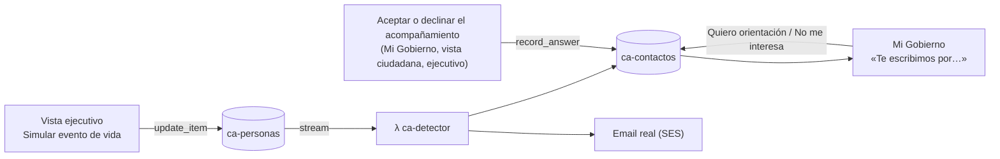

# App conectada con la detección proactiva en AWS

Cierra las tres conexiones que faltaban entre la app Streamlit y [[deteccion-proactiva-aws]] para que la demo sea un solo recorrido desde la app, sin la terminal.

## 1. Simular un evento de vida desde la app
- En **Vista ejecutivo → Contactos AWS**, el bloque «Simular evento de vida» cambia la edad, hijos, estado civil, accidente laboral, tramo RSH o días fuera de Chile de una persona en `ca-personas`.
- La app **solo escribe el dato de la persona**: la detección, el email y el escalamiento siguen corriendo en las Lambdas, igual que con `scripts/proactivo.py evento`. La app espera unos segundos y muestra los contactos nuevos.
- «Reiniciar a esta persona» borra sus contactos e historial para repetir la demo (equivale a `proactivo.py reiniciar`).

## 2. Mi Gobierno muestra lo que AWS le envió
- Al entrar, Mi Gobierno consulta `ca-contactos` por el RUN (consulta por clave, no un scan) y muestra un aviso por beneficio: «Te escribimos por…» con el motivo personal y los canales usados, o el resultado si ya respondió (próximo paso o «no volveremos a escribirte»).
- Si AWS no está disponible (credenciales vencidas), el ciudadano no ve nada: el aviso técnico queda solo en la vista del ejecutivo.

## 3. Una respuesta en la app detiene el escalamiento en AWS
- `casos.responder_invitacion` notifica a los oyentes registrados; `app.py` registra la sincronización con AWS. El núcleo `casos` no depende de AWS y los scripts (`verificar.py`) no escriben en la nube.
- Aceptar el acompañamiento registra `acepto` y declinarlo registra `rechazo` en **todos los contactos abiertos** de ese RUN, con `Service.record_answer` (el mismo código de la Lambda de respuesta): se detienen email, SMS y terreno ([[0012-detener-contacto-confirmado]]).
- En Mi Gobierno, los botones del aviso responden **solo ese beneficio**.
- La primera respuesta gana, como en la Lambda: reabrir un rechazo en la app no cambia el contacto en AWS.
- Revocar la autorización de datos no es declinar el contacto: no se sincroniza.
- Si AWS falla, la respuesta queda registrada en la app y el error va al log.
- `CA_AWS=0` desconecta la app de AWS (ni lee ni escribe; la vista del ejecutivo lo avisa). Los tests lo fijan en `tests/conftest.py` para no tocar la cuenta real; los que prueban AWS usan moto.

## Verificación
- `tests/test_aws_contactos.py`: evento sobre `ca-personas`, aviso con sus textos, sincronización (la primera respuesta gana), reinicio, oyentes de `casos` y dos pruebas de UI (simulador y aviso en Mi Gobierno).

## Fuera de alcance
Unificar SQLite y DynamoDB, y un solo motor de reglas: quedan en los próximos pasos de [[arquitectura-chileatiende]].
