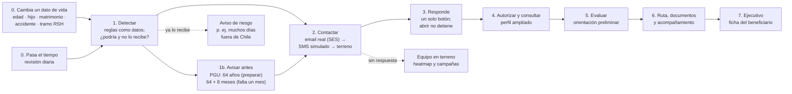
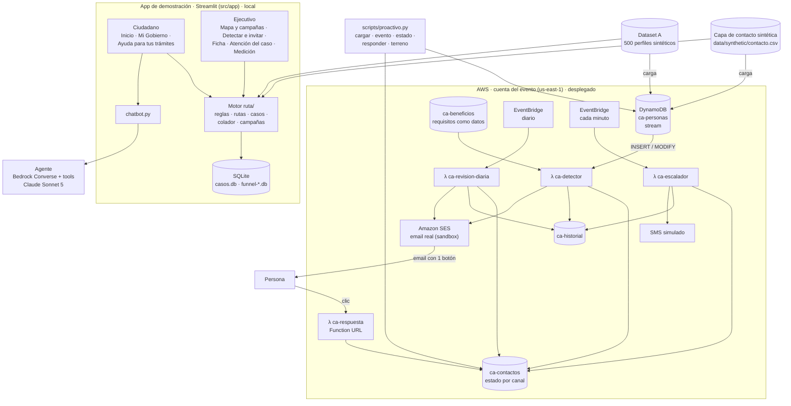

# Arquitectura — ChileAtiende a tiempo

**Revisión 15-10 (tarde):** esta nota describe lo que **existe hoy**, no solo lo planificado. Hay tres bloques:
1. **App de demostración** (Streamlit, `src/app/`): portal ciudadano, Mi Gobierno y herramientas del ejecutivo, con reglas, casos y colador en SQLite local.
2. **Agente** (`src/agent/`, `src/contracts/`, `src/tools/`): Bedrock Converse con herramientas; el chatbot de la app lo usa.
3. **Detección proactiva en AWS** (`src/proactivo/`, `infra/`): **desplegada** en la cuenta del evento. Un cambio en los datos de una persona dispara la detección y un email real (SES). Diseño en [[deteccion-proactiva-aws]].

Los bloques 1 y 3 **todavía no comparten datos**: la app usa su SQLite y su motor (`src/app/ruta/reglas.py`); AWS usa DynamoDB y el catálogo de `src/proactivo/`. Unificarlos es el siguiente paso (ver al final).

Reglas vigentes: [[0012-detener-contacto-confirmado]] (responder o aceptar detiene los canales siguientes; abrir no), elegibilidad y plazos en código con fuente, todo resultado es **aparente** y los montos son **referenciales**. Decisiones previas: [[0002-seleccion-reto]], [[0003-orquestacion-agente]], [[0004-mvp-jubilacion-pgu]], [[0005-asistente-contacto-escalonado]].

## Pipeline medular

| Paso | Dónde está hoy |
|---|---|
| 0–2 por evento o por tiempo | **AWS**: stream de `ca-personas` → Lambda `ca-detector`; `ca-revision-diaria` (08:00 Chile) |
| 2 escalamiento | **AWS**: `ca-escalador` cada minuto (5 min por canal en demo). **App**: colador email → llamada → trabajo → presencial con reloj simulado |
| 3 respuesta | **AWS**: URL `ca-respuesta` (apertura, entrar, aceptar). **App**: invitación y autorización en la vista ciudadana |
| 4–6 | **App**: `ui_persona` y Mi Gobierno, con el motor `ruta/reglas.py` y `ruta/rutas.py`; chatbot con el agente |
| 7 y terreno | **App**: ficha del beneficiario, heatmap metropolitano y área de campaña. **AWS**: `scripts/proactivo.py terreno` lista por comuna |

## Vista de componentes

## Componentes
| # | Componente | Dónde | Estado |
|---|---|---|---|
| 1 | **Portal ciudadano** | `src/app/app.py`, `portal.py`, `ui_persona.py`, `ui_government.py` | Hecho (Streamlit local): Inicio, Mi Gobierno, Ayuda para tus trámites |
| 2 | **Herramientas del ejecutivo** | `ui_campanas.py`, `ui_embudo.py`, `ui_ficha.py`, `app.py` | Hecho: mapa de calor y campañas, detectar e invitar, ficha, atención del caso, medición |
| 3 | **Motor de reglas PGU y rutas (app)** | `src/app/ruta/reglas.py`, `rutas.py` | Hecho; verificado con `verificar.py` sobre los 500 perfiles |
| 4 | **Colador de contacto (app)** | `src/app/ruta/colador.py` | Hecho en simulación con reloj; contacto confirmado detiene los canales |
| 5 | **Heatmap y área de campaña** | `campanas.py`, `despliegue.py`, `geografia.py` | Hecho con direcciones ficticias en la RM |
| 6 | **Agente** | `src/agent/` | Hecho; sin `src/rules` solo expone `consultar_perfil` y `leer_caso` |
| 7 | **Contratos y perfil autorizado** | `src/contracts/`, `src/tools/` | Hecho |
| 8 | **Detección proactiva por evento** | `src/proactivo/servicio.py`, λ `ca-detector` | **Desplegado en AWS**: 8 beneficios, motivo personal («Usted cumplió 65 años») |
| 9 | **Avisos por etapa y riesgo** | `catalogo.py` (`avisos_previos`, `riesgos`), λ `ca-revision-diaria` | **Desplegado**: PGU a los 64, 64 + 8 meses, 65 (felicitaciones) y aviso de posible pérdida |
| 10 | **Contacto multicanal en AWS** | λ `ca-escalador`, `ca-respuesta`, SES | **Desplegado**: email real a casillas verificadas, SMS simulado, terreno; registra envío, apertura, clic y respuesta |
| 11 | **Correos** | `src/proactivo/mensajes.py` | Hecho: marca ChileAtiende · Instituto de Previsión Social, registro formal, 1 botón, aviso de resultado aparente y montos referenciales |
| 12 | **Infraestructura** | `infra/` (CDK, stack `ChileAtiendeProactivo`) | Desplegado; guía en `infra/README.md` |
| 13 | **Alerta CESFAM** | — | Por hacer (base legal pendiente) |
| 14 | **Simulador y medición del KPI ≥75%** | — | Por hacer |

## Datos en AWS
| Tabla | Clave | Contenido |
|---|---|---|
| `ca-personas` | `run` | Atributos que leen las reglas (fecha de nacimiento, hijos, estado civil, tramo RSH, accidente, días fuera…); stream |
| `ca-beneficios` | `beneficio_id` | Catálogo: requisitos, avisos previos, riesgos, textos y fuente |
| `ca-contactos` | `run` + `beneficio_id` | `tipo` (aviso, disponible, riesgo), `estado`, `email_enviado/abierto/click`, `sms_enviado`, `terreno`, `respuesta`, `paso_siguiente` |
| `ca-historial` | `run` + `sk` | Cada detección, envío, apertura, escalamiento y respuesta |

## Modelos (allowlist de la cuenta del evento)
| Uso | Modelo |
|---|---|
| Agente | `us.anthropic.claude-sonnet-5` |
| Simulador, resúmenes y tareas baratas | `us.anthropic.claude-haiku-4-5` |
| Respaldo para razonamiento difícil | `us.anthropic.claude-opus-5` |

La detección proactiva y los correos **no usan LLM**: son reglas y plantillas deterministas.

## Próximos pasos
1. **Unificar datos:** que la app lea `ca-contactos` y `ca-historial` (ficha del beneficiario y embudo) en vez de su SQLite, o que el colador escriba en DynamoDB.
2. **Unificar motores:** un solo motor PGU (app y AWS hoy tienen reglas equivalentes por separado) y exponerlo al agente como `evaluar_pgu` / `calcular_hitos`.
3. **Verificar el catálogo** con las fichas oficiales: hoy solo la PGU está verificada; el umbral de «6 meses fuera de Chile» no está confirmado con el IPS.
4. Alerta CESFAM, medición del KPI de próximo paso y simulador.

## Decisiones
- [x] Orquestación: Converse + tool use propio → [[0003-orquestacion-agente]]
- [x] Idea central: asistente + contacto escalonado + heatmap + acompañamiento → [[0005-asistente-contacto-escalonado]]
- [x] Capa de contacto: sintética (`data/synthetic/contacto.csv`) mientras no haya datos de los mentores → [[contacto-y-campanas]]
- [x] Frontend de la demo: Streamlit
- [x] Envío de emails: **real con SES** solo a casillas verificadas (sandbox); SMS y llamadas **simulados** → [[deteccion-proactiva-aws]]
- [ ] Base legal del contacto laboral, de la alerta CESFAM y uso de la marca ChileAtiende: confirmar con los mentores
- [ ] Datos únicos entre la app y AWS
