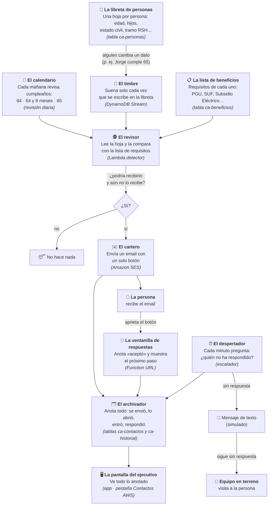
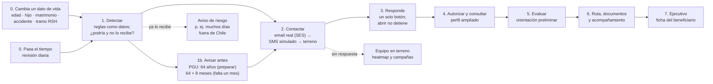
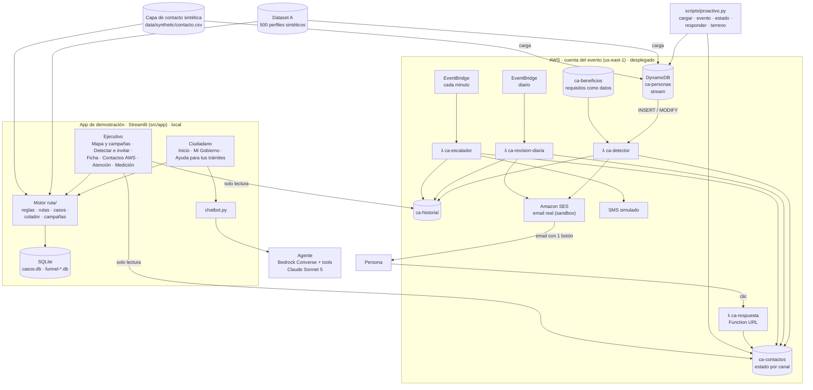

# Arquitectura — ChileAtiende a tiempo

**Revisión 15-10 (tarde):** esta nota describe lo que **existe hoy**, no solo lo planificado. Hay cuatro bloques:
1. **App de demostración** (Streamlit, `src/app/`): portal ciudadano, Mi Gobierno y herramientas del ejecutivo, con reglas, casos y colador en SQLite local.
2. **Agente** (`src/agent/`, `src/contracts/`, `src/tools/`): Bedrock Converse con herramientas; el chatbot de la app lo usa.
3. **Detección proactiva en AWS** (`src/proactivo/`, `infra/`): **desplegada** en la cuenta del evento. Un cambio en los datos de una persona dispara la detección y un email real (SES). Diseño en [[deteccion-proactiva-aws]].
4. **API del chatbot en AWS** (`src/api/`, `src/cases/`, `infra/chat_stack.py`): **desplegada**, con consentimiento, evaluación determinista, casos e historial DynamoDB y continuidad de tres turnos verificada. Cliente en `scripts/chat.py`; Streamlit sigue usando su adaptador local. Phoenix opcional y evals DeepEval en [[chatbot-desplegado]].

Los bloques 1 y 3 se conectan **solo para lectura**: la pestaña **Contactos AWS** y la ficha del beneficiario de la app muestran lo que AWS detectó, envió y registró (`src/app/ruta/aws_contactos.py`). La app sigue usando su SQLite y su motor (`src/app/ruta/reglas.py`) para lo demás; unificar el motor es el siguiente paso (ver al final).

## Explicado sin tecnicismos
Para quien no viene de ingeniería de software: así funciona la parte automática, como si fuera una oficina con personas y muebles. Cada caja dice entre paréntesis cómo se llama la pieza real.

**Un ejemplo con Jorge, paso a paso**
1. **Jorge cumple 64.** El calendario lo nota y el revisor ve que en 9 meses podrá pedir la PGU. El cartero le envía «Prepare su trámite» con la lista de documentos. Es solo un aviso: nadie lo persigue si no responde.
2. **Jorge cumple 64 años y 8 meses.** Llega «Falta un mes: el … se abre su solicitud».
3. **Jorge cumple 65.** Llega «Felicitaciones: aparentemente usted es elegible para la PGU», con un botón.
4. **Si aprieta el botón,** la ventanilla anota «aceptó» y le muestra su próximo paso. Se acaba el contacto.
5. **Si no responde,** a los 5 minutos de demo (en la vida real serían días) el despertador manda un SMS, y si sigue sin responder, lo asigna al equipo en terreno.
6. **Todo el tiempo,** el ejecutivo puede ver en la app en qué paso va Jorge y qué se le envió.

**Tres reglas que nunca cambian**
- **Decide el código, no la IA:** los requisitos están escritos en la lista y se comparan siempre igual.
- **Todo es «aparente»:** el correo orienta; el IPS revisa y resuelve. Los montos son referenciales.
- **Abrir no es responder:** solo apretar el botón (o una respuesta por teléfono o en terreno) detiene el contacto.

| Palabra técnica | En simple | En nuestro proyecto |
|---|---|---|
| Base de datos / tabla | Un cuaderno ordenado | `ca-personas`, `ca-beneficios`, `ca-contactos`, `ca-historial` (DynamoDB) |
| Stream | Un timbre que suena al escribir en el cuaderno | Avisa al revisor cada vez que cambia una persona |
| Lambda | Un trabajador que solo aparece cuando lo llaman | Revisor, despertador, calendario y ventanilla |
| EventBridge | Un despertador o calendario | Cada minuto (escalar) y cada mañana (cumpleaños) |
| SES | Un servicio de correo | Envía los emails reales (por ahora solo a casillas verificadas) |
| Function URL | Una dirección web pública | Donde llegan los clics del botón del email |
| CDK / desplegar | La receta para armar todo en AWS de una vez | Carpeta `infra/`; `cdk deploy` arma o actualiza la oficina |
| Streamlit | La pantalla de la demo | La app con el portal ciudadano y las herramientas del ejecutivo |

Reglas vigentes: [[0012-detener-contacto-confirmado]] (responder o aceptar detiene los canales siguientes; abrir no), elegibilidad y plazos en código con fuente, todo resultado es **aparente** y los montos son **referenciales**. Decisiones previas: [[0002-seleccion-reto]], [[0003-orquestacion-agente]], [[0004-mvp-jubilacion-pgu]], [[0005-asistente-contacto-escalonado]].

## Pipeline medular

| Paso | Dónde está hoy |
|---|---|
| 0–2 por evento o por tiempo | **AWS**: stream de `ca-personas` → Lambda `ca-detector`; `ca-revision-diaria` (08:00 Chile) |
| 2 escalamiento | **AWS**: `ca-escalador` cada minuto (5 min por canal en demo). **App**: colador email → llamada → trabajo → presencial con reloj simulado |
| 3 respuesta | **AWS**: URL `ca-respuesta` (apertura, entrar, aceptar). **App**: invitación y autorización en la vista ciudadana |
| 4–6 | **App**: `ui_persona` y Mi Gobierno, con el motor `ruta/reglas.py` y `ruta/rutas.py`; chatbot con el agente |
| 7 y terreno | **App**: ficha del beneficiario, heatmap metropolitano y área de campaña. **AWS**: `scripts/proactivo.py terreno` lista por comuna |

## Vista de componentes

## Componentes
| # | Componente | Dónde | Estado |
|---|---|---|---|
| 1 | **Portal ciudadano** | `src/app/app.py`, `portal.py`, `ui_persona.py`, `ui_government.py` | Hecho (Streamlit local): Inicio, Mi Gobierno, Ayuda para tus trámites |
| 2 | **Herramientas del ejecutivo** | `ui_campanas.py`, `ui_embudo.py`, `ui_ficha.py`, `ui_aws.py`, `app.py` | Hecho: mapa de calor y campañas, detectar e invitar, ficha, **contactos AWS**, atención del caso, medición |
| 3 | **Motor de reglas PGU y rutas (app)** | `src/app/ruta/reglas.py`, `rutas.py` | Hecho; verificado con `verificar.py` sobre los 500 perfiles |
| 4 | **Colador de contacto (app)** | `src/app/ruta/colador.py` | Hecho en simulación con reloj; contacto confirmado detiene los canales |
| 5 | **Heatmap y área de campaña** | `campanas.py`, `despliegue.py`, `geografia.py` | Hecho con direcciones ficticias en la RM |
| 6 | **Agente** | `src/agent/` | Hecho; sin `src/rules` solo expone `consultar_perfil` y `leer_caso` |
| 7 | **Contratos y perfil autorizado** | `src/contracts/`, `src/tools/` | Hecho |
| 8 | **Detección proactiva por evento** | `src/proactivo/servicio.py`, λ `ca-detector` | **Desplegado en AWS**: 8 beneficios, motivo personal («Usted cumplió 65 años») |
| 9 | **Avisos por etapa y riesgo** | `catalogo.py` (`avisos_previos`, `riesgos`), λ `ca-revision-diaria` | **Desplegado**: PGU a los 64, 64 + 8 meses, 65 (felicitaciones) y aviso de posible pérdida |
| 10 | **Contacto multicanal en AWS** | λ `ca-escalador`, `ca-respuesta`, SES | **Desplegado**: email real a casillas verificadas, SMS simulado, terreno; registra envío, apertura, clic y respuesta |
| 11 | **Correos** | `src/proactivo/mensajes.py` | Hecho: marca ChileAtiende · Instituto de Previsión Social, registro formal, 1 botón, aviso de resultado aparente y montos referenciales |
| 12 | **Infraestructura** | `infra/` (CDK, stack `ChileAtiendeProactivo`) | Desplegado; guía en `infra/README.md` |
| 12b | **App conectada con AWS** | `src/app/ruta/aws_contactos.py`, `ui_aws.py` | Hecho: métricas, filtros, contactos e historial (también en la ficha); **simular evento de vida** desde la Vista ejecutivo; **Mi Gobierno muestra el aviso recibido** y responde por beneficio; aceptar o declinar el acompañamiento en la app **detiene el escalamiento en AWS** ([[app-aws-conectada]]). Si las credenciales vencen, avisa en vez de fallar |
| 13 | **Alerta CESFAM y derivación** | `src/app/ruta/derivaciones.py`, `ui_cesfam.py` | Hecho en simulación: **Punto CESFAM** solo indica «Derivar a ChileAtiende» ante alerta máxima (colador en etapa 4 o contacto AWS en terreno); la derivación llega a Atención del caso con un resumen por código ([[cesfam-derivacion]]). Base legal pendiente |
| 14 | **Medición del KPI ≥75%** | `src/app/ruta/kpi.py`, Medición | Hecho: próximo paso válido dentro de un plazo de demo de 30 días, sobre la cohorte con plazo cumplido; avance provisional aparte ([[kpi-proximo-paso]]). Falta la confirmación del organismo y el plazo por trámite |

## Datos en AWS
| Tabla | Clave | Contenido |
|---|---|---|
| `ca-personas` | `run` | Atributos que leen las reglas (fecha de nacimiento, hijos, estado civil, tramo RSH, accidente, días fuera…); stream |
| `ca-beneficios` | `beneficio_id` | Catálogo: requisitos, avisos previos, riesgos, textos y fuente |
| `ca-contactos` | `run` + `beneficio_id` | `tipo` (aviso, disponible, riesgo), `estado`, `email_enviado/abierto/click`, `sms_enviado`, `terreno`, `respuesta`, `paso_siguiente` |
| `ca-historial` | `run` + `sk` | Cada detección, envío, apertura, escalamiento y respuesta |

## Modelos (allowlist de la cuenta del evento)
| Uso | Modelo |
|---|---|
| Agente | `us.anthropic.claude-sonnet-5` |
| Simulador, resúmenes y tareas baratas | `us.anthropic.claude-haiku-4-5` |
| Respaldo para razonamiento difícil | `us.anthropic.claude-opus-5` |

La detección proactiva y los correos **no usan LLM**: son reglas y plantillas deterministas.

## Próximos pasos
1. **Unificar datos:** la app ya lee `ca-contactos` y `ca-historial`, dispara eventos y registra respuestas en AWS ([[app-aws-conectada]]); falta que el colador y los casos de la app escriban en DynamoDB en vez de SQLite.
2. **Unificar motores:** un solo motor PGU (app y AWS hoy tienen reglas equivalentes por separado) y exponerlo al agente como `evaluar_pgu` / `calcular_hitos`.
3. **Verificar el catálogo** con las fichas oficiales: hoy solo la PGU está verificada; el umbral de «6 meses fuera de Chile» no está confirmado con el IPS.
4. **Validar con el organismo:** plazo por trámite y confirmación del paso para el KPI ([[kpi-proximo-paso]]); base legal de la alerta CESFAM ([[cesfam-derivacion]]).

## Decisiones
- [x] Orquestación: Converse + tool use propio → [[0003-orquestacion-agente]]
- [x] Idea central: asistente + contacto escalonado + heatmap + acompañamiento → [[0005-asistente-contacto-escalonado]]
- [x] Capa de contacto: sintética (`data/synthetic/contacto.csv`) mientras no haya datos de los mentores → [[contacto-y-campanas]]
- [x] Frontend de la demo: Streamlit
- [x] Envío de emails: **real con SES** solo a casillas verificadas (sandbox); SMS y llamadas **simulados** → [[deteccion-proactiva-aws]]
- [ ] Base legal del contacto laboral, de la alerta CESFAM y uso de la marca ChileAtiende: confirmar con los mentores
- [x] Respuestas de la app sincronizadas con AWS (aceptar/declinar detiene el escalamiento) → [[app-aws-conectada]]
- [ ] Datos únicos entre la app y AWS (hoy: casos y colador de la app siguen en SQLite)
