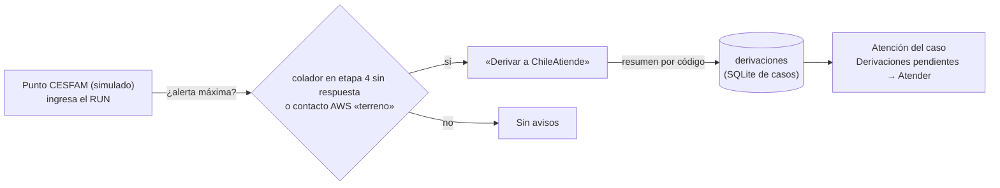

# Punto de atención CESFAM y derivación al ejecutivo

Cierra el último eslabón del colador ([[contacto-y-campanas]]): quien **no respondió a ningún canal** puede aparecer en otro servicio del Estado. Un CESFAM simulado solo sabe que debe derivarla a ChileAtiende; el ejecutivo recibe la derivación con un resumen del caso calculado por código.

## Alerta máxima
- **Colador de la app:** `ficha.alert_level` en nivel máximo (etapa 4 activa: no respondió por email, llamada ni trabajo).
- **Detección en AWS:** un contacto en estado `terreno` (email y SMS sin respuesta en plazo).
- Basta una de las dos. Si AWS no está disponible, se usa solo el colador.

## Qué ve el CESFAM
- Solo el RUN y una de dos respuestas: «Derivar a ChileAtiende» o «Sin avisos de ChileAtiende».
- **No ve** beneficios, montos, motivos ni canales: un centro de salud no necesita saber de pensiones para derivar. La base legal de esta alerta sigue por validar con los mentores.
- El botón «Derivar a ChileAtiende» crea la derivación una sola vez mientras esté pendiente.

## Qué recibe el ejecutivo
- Una derivación (`src/app/ruta/derivaciones.py`, tabla `derivaciones` en la misma base SQLite de los casos) con origen, fecha, motivo interno y un **resumen congelado al derivar**: persona, alerta, beneficio PGU (resultado y motivo), invitación y canal, autorización, documentos (solo con autorización vigente), próximo paso de la ruta y contactos AWS con su estado.
- El resumen se arma con código desde la ficha ([[ficha-beneficiario]]) y los contactos AWS; no usa LLM.
- En **Atención del caso**, «Derivaciones pendientes» lista cada una con su resumen y el botón «Atender», que abre el caso y la marca atendida por el ejecutivo de la sesión.
- La derivación queda en el historial del caso (evento `derivacion`) y en la trazabilidad.

## Verificación
- `tests/test_derivaciones.py`: alerta desde el colador y desde AWS, el resumen respeta la autorización, no se duplica una derivación pendiente, atender la cierra; prueba de UI del punto CESFAM y de la bandeja del ejecutivo.

## Fuera de alcance
Integración real con CESFAM, base legal y notificar a la persona de la derivación.
