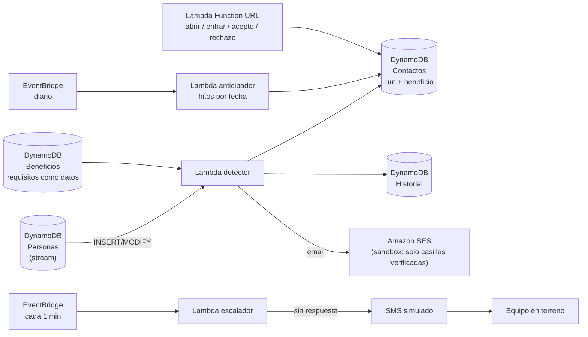

# Detección proactiva de beneficios en AWS

Cuando cambia un dato de una persona (cumple 18, tiene un hijo, se casa, sufre un accidente laboral, cambia su tramo del RSH), el sistema **detecta solo** si ahora puede optar a un beneficio que no está recibiendo, **la contacta** y **registra cada intento y su respuesta**. Generaliza el colador de [[contacto-y-campanas]] desde la PGU a cualquier evento de vida y respeta [[0012-detener-contacto-confirmado]].

**Demo estrella:** se cambia la fecha de nacimiento (o los hijos, el estado civil o el tramo) de una persona en DynamoDB y, segundos después, llega un email real a la casilla verificada.

## Arquitectura

| Pieza | Qué hace |
|---|---|
| `Personas` | Un ítem por RUN con los atributos que usan las reglas. Su **stream** dispara la detección en cada cambio. |
| `Beneficios` | Catálogo. Cada requisito es un dato `{campo, op, valor}`; se puede editar sin desplegar código. |
| `Contactos` | Estado actual por persona y beneficio: email enviado/abierto/entró, SMS enviado, terreno, respuesta, próximo paso. |
| `Historial` | Bitácora inmutable de cada detección, intento y respuesta (lo que verá el ejecutivo). |
| Lambda detector | Compara la imagen anterior y la nueva, evalúa los beneficios afectados y abre un contacto solo si **ahora** cumple, **antes no** y **no lo recibe**. |
| Lambda anticipador | Diario. La edad cambia sin que nadie edite la base: detecta a quien cumplirá un requisito de edad dentro de la ventana de anticipación (`anticipar_dias`) para que cobre apenas pueda. |
| Lambda escalador | Cada minuto. Sin respuesta tras la espera: email → SMS → equipo en terreno. |
| Lambda respuesta | URL pública con token por contacto: píxel de apertura, «ver detalle» (entró), «acepto» y «no me interesa». |

## Estados del contacto

| Estado | Significado | Siguiente acción |
|---|---|---|
| `email_enviado` | Email enviado (real o simulado) | Tras `ESPERA_EMAIL_MIN` sin respuesta → SMS |
| `sms_enviado` | SMS simulado | Tras `ESPERA_SMS_MIN` sin respuesta → terreno |
| `terreno` | Sin respuesta por canales remotos; `respuesta = sin_respuesta` | Lo visita el equipo en terreno |
| `aceptado` | Respondió que sí | Se detienen los canales; `paso_siguiente` guía el trámite |
| `rechazado` | Respondió que no | Se detiene todo; no se insiste |

- **Abrir o entrar no es responder:** `email_abierto` y `email_click` se registran, pero no detienen el escalamiento.
- Si falta el email o el teléfono, se salta ese canal y se registra el motivo.
- Un contacto por persona y beneficio. Si un contacto anticipado (`tipo = anticipado`) pasa a disponible, se envía un segundo aviso «ya puedes solicitar».
- Las esperas son de **demo en minutos**; en producción serían días (ver [[contacto-y-campanas]]).

## Reglas
- Las reglas se evalúan en código determinista (`src/proactivo/reglas.py`), nunca con el LLM. Campo ausente = **falta antecedente**: no se contacta como elegible.
- Se excluye a fallecidos y a quien ya tiene el beneficio en `beneficios_vigentes`.
- Campos derivados: `edad` y `anios_casado` desde las fechas, a la fecha de evaluación.
- El catálogo de demo (`src/proactivo/catalogo.py`) es **ilustrativo**: solo la PGU cita su ficha oficial; los demás quedan `verificado: false` hasta contrastarlos con ChileAtiende. No se informan montos.

## Datos y privacidad
- Se cargan los 500 perfiles sintéticos del dataset A, con emails `@example.com` que **nunca** se envían (quedan como `email_simulado`).
- Solo las direcciones de `EMAILS_REALES` (verificadas en SES) reciben correo real. Hoy: la casilla de Clemente.
- `utem.cl` publica DMARC `p=quarantine` estricto; un email con remitente `@utem.cl` enviado desde SES sin DKIM del dominio puede caer en spam. El remitente es configurable (`REMITENTE`).
- La URL de respuesta no expone datos: solo valida un token aleatorio por contacto.

## Operación
Ver `infra/README.md`: despliegue con CDK, carga de datos y guion de la demo.
