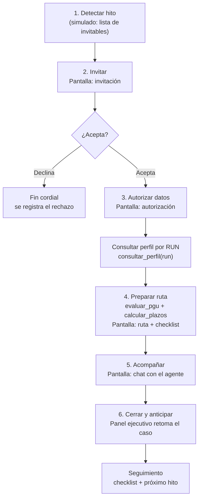

# UX y flujo de la demo — ChileAtiende a Tiempo

Wireframe y flujo de la demo para el MVP **jubilación + PGU** ([[0004-mvp-jubilacion-pgu]]). Base de las vistas Streamlit (T23 persona, T24 ejecutivo) y del guion de la demo (T28). Sigue la experiencia objetivo del PPT ([[contexto-compartido-chileatiende]]) y la arquitectura aceptada ([[arquitectura-chileatiende]]).

> **Principio del dominio:** la IA **orienta** y el organismo **resuelve**. `elegible` es una orientación preliminar, nunca una adjudicación de PGU. Toda cifra, monto o requisito sale de código + catálogo con fuente, nunca del LLM.

## 1. Flujo de experiencia

Paso a paso propuesto para la solución. Las dos vistas (persona y ejecutivo) operan sobre **el mismo caso**.



**Nota de autorización:** la detección usa solo señales autorizadas. El perfil ampliado (`consultar_perfil`) se consulta **después** de aceptar y autorizar. Si la persona declina, el flujo no continúa.

## 2. Vista de la persona (chat web · T23)

Flujo lineal de pantallas. Lenguaje claro, letra grande, sin logos oficiales.

### 2.1 Invitación

```
┌───────────────────────────────────────────────┐
│  ChileAtiende a Tiempo                          │
│                                                 │
│  Hola, Rosa 👋                                  │
│                                                 │
│  Nos pusimos en contacto porque se acerca un    │
│  hito importante: podrías tener derecho a la    │
│  Pensión Garantizada Universal (PGU).           │
│                                                 │
│  Queremos ayudarte a prepararte con tiempo.     │
│  ¿Quieres que revisemos juntos tu situación?    │
│                                                 │
│   [ Sí, acompáñenme ]   [ Ahora no, gracias ]   │
│                                                 │
│  Esto es una orientación. La decisión final la  │
│  toma el IPS.                                    │
└───────────────────────────────────────────────┘
```

- **Acepta** → pantalla de autorización.
- **Declina** → mensaje cordial de cierre; se registra el rechazo (ver estado "declina").

### 2.2 Autorización de datos

```
┌───────────────────────────────────────────────┐
│  Para prepararte una ruta, necesitamos revisar: │
│                                                 │
│   • Registro Civil (edad, estado)               │
│   • Registro Social de Hogares (RSH)            │
│   • Años de residencia en Chile                 │
│   • Previsión y pensiones (AFP / IPS)           │
│                                                 │
│  ¿Para qué? Para ver si cumples los requisitos  │
│  de la PGU y decirte qué te falta.              │
│                                                 │
│   [ Autorizo el uso de mis datos ]              │
│   [ No autorizo ]                               │
└───────────────────────────────────────────────┘
```

- **Autoriza** → se llama a `consultar_perfil(run)` y se arma la ruta.
- **No autoriza** → cierre cordial, mismo tratamiento que "declina".

### 2.3 Ruta + checklist

El contenido cambia según el estado devuelto por `evaluar_pgu` (ver §4).

```
┌───────────────────────────────────────────────┐
│  Tu ruta para la PGU                            │
│  Estado preliminar:  ✅ Podrías ser elegible    │
│                                                 │
│  Por qué:                                       │
│   • Tienes 65 años cumplidos                    │
│   • Cumples los años de residencia              │
│   • No estás en el 10% de mayores ingresos      │
│                                                 │
│  Qué debes hacer:                               │
│   ☐ Reunir cédula de identidad vigente          │
│   ☐ Solicitar la PGU en ChileAtiende            │
│   ☐ (si aplica) Actualizar tu RSH               │
│                                                 │
│  Plazo: puedes solicitarla desde los 64 a 9 m   │
│  Canal: oficina ChileAtiende / web              │
│  Fuente: [ficha PGU]  ← desde el catálogo       │
│                                                 │
│   [ Tengo dudas, conversemos ]                  │
└───────────────────────────────────────────────┘
```

- Cada paso del checklist es marcable. El estado se guarda en el caso y lo ve el ejecutivo.
- Cada afirmación de requisito/plazo/monto muestra su `fuente_url` del catálogo.

### 2.4 Chat con el agente

```
┌───────────────────────────────────────────────┐
│  Conversación                                   │
│  ┌─────────────────────────────────────────┐   │
│  │ 🤖 Hola Rosa, puedo explicarte cualquier  │   │
│  │    paso de tu ruta. ¿Qué quieres saber?   │   │
│  │                                           │   │
│  │              ¿Qué es la pensión base? 👤  │   │
│  │                                           │   │
│  │ 🤖 Es la suma de tus pensiones vigentes.  │   │
│  │    En tu caso es $0, por eso... [fuente]  │   │
│  └─────────────────────────────────────────┘   │
│  [ Escribe tu mensaje...            ] [Enviar]  │
└───────────────────────────────────────────────┘
```

- El agente responde citando fuentes. No inventa montos ni reglas.
- La conversación se guarda en el historial del caso (continuidad entre canales).

## 3. Panel del ejecutivo (vista de sucursal · T24)

Una sola pantalla con buscador + ficha del caso.

```
┌─────────────────────────────────────────────────────────────┐
│  Panel ejecutivo · ChileAtiende                               │
│  Buscar RUN: [ 12.345.678-9 ]  [Buscar]                       │
├─────────────────────────────────────────────────────────────┤
│  Rosa Pérez · 65 años          Estado: ✅ Elegible (prelim.)  │
│                                                               │
│  Motivos:                     Ruta:                           │
│   • Edad ≥ 65                   1. Reunir cédula               │
│   • Residencia OK               2. Solicitar PGU              │
│   • PFP ≤ 90                     3. Actualizar RSH (si aplica) │
│                                                               │
│  Checklist:                   Hitos / plazos:                 │
│   ☑ Cédula vigente              • PGU desde 64a 9m            │
│   ☐ Solicitó PGU                • Cumple 65: 2026-11-02       │
│   ☐ RSH actualizado                                           │
│                                                               │
│  Historial del caso (por canal):                              │
│   • 14:02 web  — aceptó invitación                            │
│   • 14:03 web  — autorizó datos                               │
│   • 14:05 web  — vio su ruta, marcó "cédula"                  │
│   • 14:20 sucursal — ejecutivo retoma                         │
└─────────────────────────────────────────────────────────────┘
```

- El ejecutivo ve exactamente el mismo caso que trabajó la persona: no le pide que repita su historia.
- Puede marcar/desmarcar el checklist; el cambio queda en el caso.
- El historial muestra el canal de cada evento (web / sucursal).

## 4. Estados de cada pantalla

### Estados del resultado (`evaluar_pgu`)
Lo que muestra la pantalla de ruta según el estado del caso:

| Estado | Vista persona | Vista ejecutivo |
|---|---|---|
| `elegible` | "Podrías ser elegible" + checklist para solicitar | Verde + ruta de solicitud |
| `no_elegible` | Explica el requisito que no cumple + alternativa si existe | Rojo + motivo del rechazo |
| `antecedente_faltante` | "Nos falta un dato": ruta para conseguirlo (ej. ingresar al RSH) y reevaluar | Ámbar + qué antecedente falta |
| `proximo` | "Aún no cumples 65, pero prepárate": qué tener listo | Azul + fecha en que cumple el hito |
| `ya_recibe` | "Ya recibes la PGU": sin acción, info de contacto | Gris + beneficio vigente |

### Estados de UI (ambas vistas)
| Estado | Qué se muestra |
|---|---|
| Cargando | Spinner + "Consultando tu información..." (mientras corre `consultar_perfil` / `evaluar_pgu`) |
| Error | Mensaje claro + botón "Reintentar"; nunca stack traces |
| Declina / No autoriza | Cierre cordial; se registra el rechazo; no se consulta el perfil |
| RUN no encontrado (ejecutivo) | "No encontramos ese RUN" + sugerencia de verificar |
| Vacío (ejecutivo) | Estado inicial antes de buscar |

## 5. Forma de los datos mock (contrato provisional)

Mientras no existan los contratos reales de Clemente (`src/contracts/`), las vistas usan estos mocks. Alineados con el pipeline y los 5 estados. **Si se necesita un campo nuevo, se pide a Clemente antes de cambiarlo.**

```json
{
  "case_id": "case-001",
  "run": "12.345.678-9",
  "persona": {
    "nombre": "Rosa Pérez",
    "edad": 65,
    "fecha_nacimiento": "1961-11-02"
  },
  "invitacion": {
    "estado": "aceptada",          // pendiente | aceptada | declinada
    "motivo": "Posible PGU no cobrada"
  },
  "autorizacion": {
    "estado": "autorizada",        // pendiente | autorizada | denegada
    "datos": ["registro_civil", "rsh", "residencia", "prevision", "pensiones"]
  },
  "evaluacion": {
    "estado": "elegible",          // elegible | no_elegible | antecedente_faltante | proximo | ya_recibe
    "motivos": [
      { "texto": "Tiene 65 años cumplidos", "fuente_url": "https://..." },
      { "texto": "Cumple años de residencia", "fuente_url": "https://..." }
    ]
  },
  "ruta": {
    "beneficio": "PGU",
    "pasos": ["Reunir cédula vigente", "Solicitar la PGU en ChileAtiende"],
    "plazo": { "texto": "Desde los 64 años y 9 meses", "fuente_url": "https://..." },
    "canal": "Oficina ChileAtiende / web"
  },
  "checklist": [
    { "id": "cedula", "texto": "Cédula de identidad vigente", "hecho": true },
    { "id": "solicitud", "texto": "Solicitar la PGU", "hecho": false },
    { "id": "rsh", "texto": "Actualizar RSH", "hecho": false }
  ],
  "hitos": [
    { "texto": "Cumple 65 años", "fecha": "2026-11-02" },
    { "texto": "Apertura de solicitud PGU", "fecha": "2026-08-02" }
  ],
  "historial": [
    { "ts": "2026-10-14T14:02", "canal": "web", "evento": "aceptó invitación" },
    { "ts": "2026-10-14T14:03", "canal": "web", "evento": "autorizó datos" },
    { "ts": "2026-10-14T14:20", "canal": "sucursal", "evento": "ejecutivo retoma" }
  ]
}
```

**3 casos mock para la demo** (T28), elegidos del dataset:
- **A** — persona próxima al hito que **acepta** → estado `proximo` o `elegible`, ruta completa.
- **B** — persona con **antecedente faltante** (sin RSH / residencia) → estado `antecedente_faltante`.
- **C** — persona que **declina** la invitación → se registra el rechazo, no se consulta perfil.

## 6. Pendientes de verificación (antes de "aprobado")

- [ ] Confirmar hitos oficiales: PGU desde **64 años y 9 meses**, acceso desde **65 si cumple requisitos** (T·humano+Claude). No usar 65 como fecha única.
- [ ] Alinear la forma del mock con los contratos de Clemente cuando existan (`src/contracts/`).
- [ ] Validar textos con alguien ajeno al proyecto (parte de T27: lenguaje claro, contraste, letra grande).
- [ ] Aprobación del equipo antes de las 21:00 del miércoles.

## Relacionado
[[arquitectura-chileatiende]] · [[contexto-compartido-chileatiende]] · [[datos-dataset-A]] · [[0004-mvp-jubilacion-pgu]] · [[_equipo]] · [[board]]
