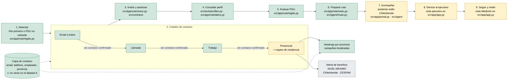

# Equipo de desarrollo

El equipo trabaja **sin tareas asignadas**: cada integrante puede aportar en cualquier parte del pipeline y registra lo que hace en su board y su bitácora. El avance de todos se ve en [[_avance]].

| Integrante | Entorno | Board |
|---|---|---|
| Clemente | Claude Code + Codex | [[board-clemente]] |
| Johann | Kiro IDE Pro, desde `src/app` | [[board-johann]] |
| Jonmor | Kiro IDE Pro | [[board-jonmor]] |
| Bruno | Kiro IDE Pro | [[board-bruno]] |
| Jp | Kiro IDE Pro | [[board-jp]] |

## Forma de trabajo
1. Commit del aporte propio.
2. Traer `origin/main` y hacer el merge.
3. Resolver conflictos y **revisar duplicaciones funcionales**: git no detecta dos implementaciones distintas de lo mismo.
4. Correr las verificaciones (`uv run --group app pytest` y `uv run --group app python src/app/verificar.py`).
5. Push. Si el remoto avanzó mientras tanto, repetir desde el paso 2.

Se mantienen las reglas del dominio: elegibilidad, montos e hitos en código y con fuente; `elegible` es orientación preliminar; sin autorización no se consulta el perfil; sin credenciales en el repo ([[AGENTS]]).

## Pipeline y estado del código

Validación local de Johann, 15-10: [[mi-gobierno]] agrega el espacio personal separado de la portada ChileAtiende, documentos/declaración y guía PGU con el motor existente. El catálogo completo y los trámites automáticos no están integrados. 139 pruebas y recorrido de navegador OK.
Es el pipeline de [[arquitectura-chileatiende]], según [[0005-asistente-contacto-escalonado]] y [[contacto-y-campanas]]. El color indica cuánto está construido en `main`.

| Color | Estado |
|---|---|
| 🟩 Verde | Funciona en `main` |
| 🟨 Amarillo | Existe en parte o falta unificarlo |
| ⬜ Gris | Por hacer |

| Etapa | Qué hay | Qué falta |
|---|---|---|
| 1. Detectar | Segmentos de campaña sobre los 500 perfiles alimentan el backend del colador | Validación institucional de reglas/datos |
| 2. Colador | Contacto confirmado detiene escalamiento; personas, intentos, respuestas e inicio separados. Backend, reloj, simulaciones y mapa ([[backend-embudo-contacto]], [[0012-detener-contacto-confirmado]]) | Transportes/visitas reales; instrumentar KPI próximo paso en plazo (meta usuario ≥75%) |
| 3–6. Invitar → ruta | App de Johann (SQLite, reglas, rutas) y, en paralelo, contratos, perfil y agente CLI | Unificar los dos motores ([[revision-aporte-johann]]): estados `futuro` y `excluido`, repositorio e historial |
| 7. Acompañar | Portal estilo ChileAtiende con chatbot conectado al agente ([[portal-ayuda-tramites]]) | Checklist de documentos y guía del trámite paso a paso |
| 8. Derivar | Vista del ejecutivo y **ficha del beneficiario** con identidad, contacto, consentimiento, evaluación, ruta, documentos, colador y alerta ([[ficha-beneficiario]]) | Resumen de derivación redactado por el asistente |
| 9. Seguir | Vista de medición con los KPI del PPT | Estado de la solicitud hasta la resolución del organismo |
| Heatmap y alerta | Mapa RM con ubicaciones ficticias, ranking, umbral 5 y área de campaña calculada por cobertura espacial, radio/capacidad y exportación GeoJSON ([[heatmap-campanas-simulado]]) | Territorios reales, autorización de domicilios, sede/rutas, agenda/despacho y alerta/CESFAM |
