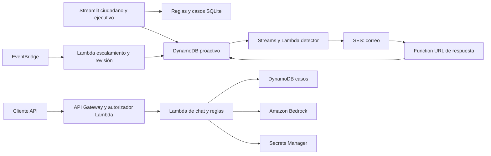

# Transferencia a AWS e IPS ChileAtiende

## Alcance entregado

Equipo Bombazo, prototipo ChileAtiende a Tiempo, 3er lugar en AWS Breaking Barriers Chile 2026. Se conservan código fuente, pruebas, lock de dependencias, infraestructura, assets de la aplicación, base de conocimiento y datos sintéticos. Se retiran de la versión de entrega los tableros de personas, bitácoras, retos alternativos, configuración de Obsidian/Kiro y material de pitch.

El historial anterior permanece disponible en Git. La limpieza de archivos de la rama no elimina su contenido de commits antiguos. No se modificaron recursos AWS ni se confirmó el estado actual de la cuenta sandbox. El código estaba conservado en GitHub, fuera de la cuenta sandbox del evento.

## Arquitectura implementada

Los logs de Lambda van a CloudWatch. La app puede invocar el agente compartido con Bedrock; sin modelo configurado en la interfaz usa plantillas. La API y Streamlit mantienen recorridos y persistencias parcialmente separados: no asumir que comparten automáticamente un caso. Las notas históricas de diseño en [arquitectura](arquitectura/arquitectura-chileatiende.md) describen decisiones del hackathon y pueden incluir propuestas aún sin implementar.

## Configuración y operación

La guía ejecutable está en [infra](../infra/README.md); el arranque local y los comandos de verificación están en [README](../README.md). Configuración de ejemplo: [.env.example](../.env.example).

| Parámetro | Uso |
|---|---|
| `AWS_REGION`, `AWS_PROFILE` | Región y perfil opcional; en AWS preferir el rol de ejecución |
| `CA_AWS` | `0` desactiva la conexión proactiva de la UI; `1` la habilita |
| `BEDROCK_MODEL_ID` | Modelo de la interfaz/agente; la API Lambda tiene su valor en CDK |
| `DATA_DIR` | Directorio con `perfiles.json`; por defecto usa el dataset versionado |
| `FECHA_REFERENCIA` | Fecha de las evaluaciones sintéticas: `2026-10-08` |
| `CASOS_DB` | Base SQLite local de la app; requiere persistencia en hosting |
| `REMITENTE` | Casilla SES para resúmenes ciudadanos |
| Contexto CDK `email` | Casilla explícita de prueba/verificación SES |

No se incluyen credenciales, archivos `.env`, bases de casos ni adjuntos generados por usuarios. Se conserva la base de conocimiento con capturas de fuentes públicas y el dataset identificado como sintético en su README. Las imágenes, marcas y contenidos de terceros deben revisarse para la publicación institucional.

## Brechas para producción y temas de la reunión

- Reemplazar las autenticaciones ficticias de ciudadanía y personal por identidad institucional, autorización por rol y controles de acceso por caso. La API usa una key compartida y encabezados de identidad del prototipo.
- Revisar la Function URL pública de respuestas, tokens, caducidad, protección contra abuso y el estado de consentimiento para contactos reales.
- Acordar hosting de Streamlit, almacenamiento de adjuntos, persistencia y migración de SQLite; unificar motores, contratos y casos con DynamoDB.
- Validar con IPS reglas, montos, fuentes, vigencias, finalidad del tratamiento y las integraciones oficiales. La orientación del prototipo no adjudica beneficios. El corpus público contiene convocatorias históricas y requiere actualización controlada.
- Sustituir el dataset sintético por integraciones autorizadas; definir cifrado, auditoría, retención, respaldos, recuperación y minimización de datos/trazas.
- Preparar cuentas y ambientes, permisos mínimos, acceso a Bedrock y SES, configuración por ambiente, monitoreo, alertas, presupuesto y pruebas de carga/seguridad. Los recursos actuales usan nombres fijos y políticas de eliminación de demo.
- Integrar canales reales y estados de entrega/rebote/respuesta; llamada, SMS, visitas y campañas territoriales están total o parcialmente simulados. Validar el KPI de próximo paso y sus plazos con el organismo.
- Acordar la licencia de código abierto y revisar derechos sobre assets/datos de terceros; el repositorio recibido no contiene LICENSE.

La síntesis y las pruebas locales permiten revisar la entrega, pero no certifican un despliegue funcional en la cuenta receptora. La validación final requiere credenciales, servicios autorizados y una prueba en el entorno acordado.
